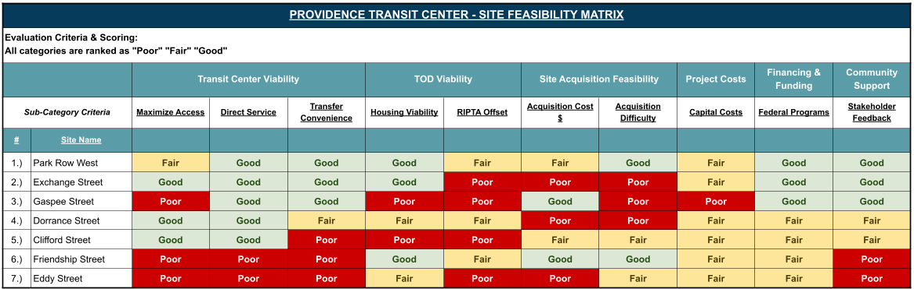

# Executive Summary {.unnumbered}

The Rhode Island Public Transit Authority (RIPTA) is proposing a
public-private partnership to move Providence's central bus hub out of
downtown's Kennedy Plaza to a new site beside Providence Station at Park
Row West and Francis Street (*hereafter referred to as* *Park Row
West*). While moving this hub would modernize aging infrastructure and
connect buses directly to commuter rail, shifting the system's anchor to
the northern edge of Downcity Providence fundamentally changes how
buses—and riders—move through the city.

This study evaluates the operational, financial, and rider-access
impacts of that move using 12 months of actual RIPTA bus-tracking
records (*covering more than 335,000 inbound trips*), published bus
schedules, U.S. Census data, and local elevation maps. Combining
historical trend analysis with machine learning, this study measures how
extended routes add to everyday travel times—and uncovers hidden
**rush-hour tipping points**—where crowded streets, tight turns, and
back-to-back buses suddenly cause delays to snowball across the network.

## Key Findings {.unnumbered}

- **Higher Operating Costs and Fleet Strain:** Providence's downtown
  transit network already runs close to capacity, where rush-hour
  traffic, narrow historic streets, and back-to-back bus arrivals create
  daily bottlenecks. Moving the hub north to Park Row West forces most
  incoming buses—especially from the East, South, and West—to push even
  deeper through downtown gridlock. Even after accounting for shorter
  trips on select Northern routes, the move adds a net **2,336 hours of
  bus service per year** (*about **6.4 hours per day***). Maintaining
  current schedules without cutting service would require **2 to 3
  additional peak buses** and impose a **net annual operating cost
  increase of \$394,279**—spending nearly \$400,000 a year simply to
  absorb longer routes with no gain in service frequency or coverage.

- **A Universal 13.4-Minute Transfer Penalty:** Closing Kennedy Plaza
  opens a third-of-a-mile (*1,820-foot*) uphill gap between the downtown
  workplaces and the new bus hub. Whether commuters walk the hill or
  wait for a connector shuttle, bridging that gap adds an average of
  **nearly 13.5 minutes** each way for riders heading to or from
  downtown.

- **A Geographic Divide with Heavy Practical Equity Costs:** Rather than
  isolating a single demographic group, the new hub's location creates a
  stark geographic divide: select Northern routes gain shorter trips and
  cost savings, while **Eastern, Southern, and Western corridors**
  absorb compounding delays. Neighborhoods with high concentrations of
  low-income, elderly, or transit-dependent residents are served by **19
  of the 30 delayed bus corridors** entering downtown. Even though the
  13.4-minute transfer penalty affects all displaced riders broadly, it
  falls hardest in practice on transit-dependent, elderly, and
  mobility-challenged riders who cannot switch to private vehicles or
  walk the uphill grade—undermining the *Transit Forward RI 2040* Master
  Plan's goal of expanding reliable transit for low-income, minority,
  and older residents.

## Key Recommendations {.unnumbered}

- **Adopt a Split-Hub and Cross-Town Strategy:** Rather than forcing
  every bus to a single northern hub, RIPTA should terminate Northern
  routes (*such as Routes 50, 55, 56, and 57*) at Park Row West to
  capture their genuine time and cost savings. Eastern, Southern, and
  Western routes should remain anchored at Kennedy Plaza or be paired
  into continuous cross-town lines (*such as Routes 1 and 92*) so riders
  keep direct Downcity access without triggering steep operating
  deficits.

- **Target Rush-Hour Bottlenecks:** Install peak-hour **Transit Signal
  Priority** (*smart traffic lights that hold green lights for
  approaching buses*) and peak-period bus lanes along Memorial Boulevard
  and Francis Street, and evaluate direct transit bypasses for
  high-frequency Southern and Eastern lines (*e.g., Routes 1, 20, 22,
  72, and 92*) to eliminate slow downtown looping.

- **Guarantee Frequent, Accessible Shuttle Service:** If a full
  relocation to Park Row West moves forward, RIPTA should mandate a
  dedicated, zero-fare shuttle running every **5 minutes or less**
  during peak and off-peak hours—paired with weather-protected,
  curb-height ('*level-boarding*') stops for wheelchairs and walkers—to
  reduce the 13.4-minute transfer penalty for seniors and
  mobility-challenged riders.

- **Test and Measure Before Finalizing:** To eliminate data blind spots
  and advance future transit equity models, equip buses with **Automated
  Passenger Counters** (*doorway sensors that log exact boardings at
  every stop*) to measure exact transfer volumes rather than relying on
  estimates. Additionally, the agency should run live peak-hour pilot
  buses along Eastern, Southern, and Western corridors to verify modeled
  delays on the street before locking in a final hub design.

# Introduction

The Rhode Island Public Transit Authority (RIPTA) and its private
development consortium, Next Wave Rhode Island Partners, are moving
forward with plans to replace Providence's central bus hub with a modern
indoor terminal. Since 1990, Kennedy Plaza (KP) has anchored Rhode
Island's statewide bus network. Project planners argue, however, that
the plaza has outgrown its footprint—citing cramped, exposed bus curbs,
crowded sidewalks shared with general downtown foot traffic, and
surrounding street congestion. Following an initial evaluation of
candidate locations across downtown, project planners narrowed their
focus to parcels adjacent to Providence Train Station (*see
@fig-aerial*).

{#fig-aerial
width="100%"}

In RIPTA's initial screening of seven candidate sites, Park Row West
scored the highest across 10 planning criteria (@tbl-matrix). Strong
public interest in connecting buses directly to Amtrak and MBTA commuter
trains at Union Station then prompted planners to add an adjacent parcel
on Francis Street[^1]—giving buses enough room to turn and circulate
around the rail station.

[^1]: Rhode Island Public Transit Authority (RIPTA), *Providence Transit
    Center Joint Development Project Task 2, Part I – Site Evaluations &
    Commercial Feasibility* (2025), 1–2.

::: {#tbl-matrix}
{width="100%"}

Providence Transit Center Site Feasibility Matrix. *Source:* Adapted
from Rhode Island Public Transit Authority (RIPTA), *Providence Transit
Center Joint Development Project Task 2, Part I – Site Evaluations &
Commercial Feasibility, 2025.*
:::

Still, moving the hub away from Kennedy Plaza has sparked fierce
pushback from riders, city councilors, and state lawmakers.[^2] While
critics agree that linking the buses directly to train service is
appealing, they point to four major drawbacks:

[^2]: Randall Rose, “Moving Kennedy Plaza Bus Hub Will Inconvenience
    RIPTA Riders and Interfere with Climate Goals,” ecoRI News, March
    13, 2024,
    <https://ecori.org/moving-kennedy-plaza-will-inconvenience-ripta-riders-and-interfere-with-climate-goals/>;
    Steve Ahlquist, “*Despite Rider Opposition, RIPTA Board Votes to
    Move the Bus Hub out of Kennedy Plaza*,” RINewsToday, August 28,
    2026,
    <https://rinewstoday.com/despite-rider-opposition-ripta-board-votes-to-move-the-bus-hub-out-of-kennedy-plaza-steve-ahlquist/>;
    Providence City Council, Resolution No. 237, passed May 16, 2024,
    effective May 26, 2024; Rhode Island General Assembly, House, An Act
    Relating to Public Utilities and Carriers – Rhode Island Public
    Transit Authority, H 7464, 2026 Sess., introduced January 30, 2026;
    Rhode Island General Assembly, Senate, An Act Relating to Public
    Utilities and Carriers – Rhode Island Public Transit Authority, S
    2680, 2026 Sess., introduced February 27, 2026.

**Transit Center Viability:** Kennedy Plaza’s infrastructure is
currently built around the flow of traffic, with Providence’s natural
road arteries funneling most bus lines towards Kennedy Plaza. It is
within a few blocks of City Hall, post office, banks, the public
library, universities, and other places people commonly travel to.

**Fiscal Priorities:** Critics note that renovating Kennedy Plaza would
cost a fraction of the hundreds of millions required to build a
brand-new terminal. Furthermore, opponents of the plan point out that
RIPTA has been severely underfunded, facing a “fiscal cliff” that
threatens imminent route and service cuts. They argue that Kennedy Plaza
already serves as transit-oriented infrastructure and that renovating
the site to address Rhode Island’s Transit Master Plan[^3] would
represent the best use of funds.

[^3]: Rhode Island Public Transit Authority, *Transit Forward RI 2040*
    (Providence, RI),
    <https://www.ripta.com/sites/default/files/2025-10/TFRI-Recs-Briefing-Book-Final-201230.pdf>.

**Transfer Burdens:** Planning reports, public hearings, a Providence
City Council resolution, and pending state bills all warn that moving
the central bus hub away from Kennedy Plaza would disrupt established
transit routes, increase trip times, and hinder overall accessibility by
forcing extra transfers for daily commuters.

**Public Process and Real Estate Interests:** Many riders expressed
frustration during public outreach sessions that Kennedy Plaza was
intentionally omitted as a choice on survey ballots. Some advocates
argue that the drive to relocate the transit hub away from Kennedy Plaza
is motivated by private real estate interests seeking to clear bus
commuters out of the downcity civic community rather than improving
transit equity.

```{r}
#| label: setup
#| echo: false
#| message: false
#| warning: false

library(tidyverse)  # Core data manipulation (dplyr, stringr, etc.)
library(readr)      # reads table data into R
library(skimr)      # Provides descriptive statistics and data summaries
library(stringi)    # R package for efficient string processing
library(knitr)      # Power R Markdown by execution of embedded R code
library(kableExtra) # Extends the basic functionality of knitr() tables
library(lubridate)  # Contains functions for working with date-time data
library(scales)     # Provides functions for labels for axes and legends
library(patchwork)  # Provides support for multiplot layouts
library(data.table) # Enhanced data frame capabilities
library(latex2exp)  # Converts LaTeX syntax to plotmath notation
library(ggforce)    # Extends ggplot2 by adding extra geometric objects
library(broom)      # Convert statistical parameters into tibbles
library(ggrepel)    # provides geoms to repel overlapping text labels.
library(grid)       # primitive graphic functions for ggplot2 
library(osrm)       # high performance routing engine
library(caret)      # Provides machine learning algorithms
library(rosm)       # Plot open source maps
library(ggspatial)  # Extends ggplot2 with cartographic plot tools
library(prettymapr) # Enables automated map formatting

options(scipen = 999) # Forces R to display numbers as fixed decimals
options(digits = 8)   # Set maximum number of digits to print to 8


```

# Problem Definition

This study tests the Park Row West proposal in three steps. First, we
analyze historical bus records to measure where and why routes already
run late heading into Kennedy Plaza today. Second, we map the exact
street detours required to reach Park Row West to calculate added
driving time, extra buses needed, and annual budget costs. Finally, we
simulate the uphill commute across the gap between the two hubs to see
whether the move places an unfair burden on transit-dependent, elderly,
and mobility-challenged neighborhoods.

## Key Questions

I.  *What causes bus delays in downtown Providence today, and how will
    extending routes to Park Row West affect on-time reliability and
    operating costs?*

II. *Does moving the hub away from Kennedy Plaza create an inequitable
    burden ('disparate impact') that hits low-income, senior, and
    mobility-challenged riders hardest?*

## Data Sources & Ingestion Framework {#sec-data-sources}

### Ideal Datasets

To test how real passengers will be affected, we started with RIPTA's
official schedules (*published in the industry-standard General Transit
Feed Specification* [^4] *(GTFS) format*) and digitally reconstructed
the route map to terminate at Park Row West.[^5] Because published
schedules only reflect ideal plans on paper, we paired them with a full
year of RIPTA's real-world GPS dispatch logs—recording the exact second
buses actually arrived at stops across the city. Finally, we linked
those routes to U.S. Census neighborhood data and RIPTA's rider surveys
to distinguish transit-dependent communities from wealthier
'non-vulnerable' commuters.[^6]

[^4]: *MobilityData, “Overview,” General Transit Feed Specification
    (GTFS) Technical Documentation, accessed September 11, 2026,
    <https://gtfs.org/documentation/overview/>.*

[^5]: Chelsey Palmateer et al., “The Synergistic Effects of Transit
    Oriented Development and Transit Hubs on Accessibility in the San
    Francisco Bay Area” (working paper, University of Minnesota, August,
    2, 2016), <https://hdl.handle.net/11299/181535>.

[^6]: Next Wave Rhode Island Partners, *Providence Transit Center Joint
    Development Project: Task 2, Part I – Site Evaluations & Commercial
    Feasibility*, report submitted to the Rhode Island Public Transit
    Authority (March 28, 2025), sec. 2.4, pp. 24–34; and Appendix 1C,
    pp. 1C-1–1C-20.

### Primary Data Summary {#sec-pri-data-sum}

#### RIPTA CAD/AVL Historical Archive

Published timetables estimate intermediate stop times mathematically,
while public live-tracking feeds (*GTFS-Realtime*) restrict how much
historical data can be downloaded. To build an exact four-season record,
we obtained a full 12-month archive of internal Computer-Aided Dispatch
and Automatic Vehicle Location (*CAD/AVL*) logs via a Rhode Island
Access to Public Records Act (APRA)[^7] request. These records log
*scheduled vs. actual* bus arrivals to the second alongside precise GPS
coordinates—allowing us to measure corridor delays just before buses hit
downtown hub congestion.

[^7]: Access to Public Records Act, R.I. Gen. Laws § 38-2-1 et seq.

#### RIPTA Kennedy Plaza Transfer Data & Passenger Counts

Next Wave Rhode Island Partners surveyed 4,438 people during public
outreach, recording home ZIP codes and trip purposes. However, the
survey did not record which specific bus routes respondents rode, and
ZIP codes are too broad to tie responses to individual lines. Moreover,
because the survey was distributed only online and at public
meetings—and included roughly 15% non-riders and infrequent riders—it
does not represent daily bus commuters as a whole. Because answering
Question II requires knowing how many incoming passengers end their trip
within a quarter-mile walk of Kennedy Plaza, we combine this survey
baseline with route-level ridership in @sec-xfr-vol.

#### U.S. Census Bureau Databases

U.S. Census Bureau block-group demographic data was extracted via the
American Community Survey (ACS) 5-Year estimates. This data—specifically
tracking median household income, race and ethnicity, zero-vehicle
households, residents with walking disabilities, and senior
populations—is used to define the study's Transit-Dependent and
Mobility-Challenged vulnerability tiers.

#### RIGIS Digital Elevation Models (DEM) & Spatial Layers

Elevation datasets from the Rhode Island Geographic Information System
(RIGIS) were paired with street and parcel boundaries to map
quarter-mile walking zones, street steepness, and effort-weighted
walking speeds.

#### Data & Analytical Environment

Full schema specifications for the RIPTA GTFS feed and an inventory of
the core R packages used in this analysis are documented in the
[**Technical Appendix**](#sec-tech-app).

# Exploratory Data Analysis (EDA): Mapping Baseline Operations & Equity

To evaluate the spatial, operational, and social equity impacts of
relocating Providence’s central transit hub from Kennedy Plaza to Park
Row West, we constructed a multi-stream exploratory data analysis (EDA)
pipeline (@fig-eda-pipeline). This analytical architecture combines
distinct data sources—including General Transit Feed Specification
(GTFS) schedule feeds, historical Computer-Aided Dispatch and Automatic
Vehicle Location (CAD/AVL) event logs, U.S. Census Bureau American
Community Survey (ACS) 5-Year estimates, Rhode Island Geographic
Information System (RIGIS) digital elevation models, and public outreach
survey responses—into five core processing modules:

1.  **GTFS Operations Engine:** Quantifies daytime peak arrival
    frequencies ($N_r$), headways, and route volume baselines ($R_r$)
    across 30 directional route-branch arrival streams.
2.  **Network Topography & Walkshed Engine:** Constructs quarter-mile
    pedestrian network buffers and models grade-adjusted walking speed
    reductions using Tobler’s Hiking Function.
3.  **Transit Equity Engine:** Characterizes Census block group $(bg)$
    vulnerability across 191 study tracts and applies route-volume
    weighting $(W_{bg})$ to establish passenger-weighted demographic
    exposure.
4.  **Passenger Disaggregation Engine:** Applies the system-wide
    outreach survey baseline $(\tau_{\text{survey}} = 0.359)$ to
    separate daily route ridership into final-destination riders
    $(D_{\text{vol}, r})$ and connecting transfer riders
    $(T_{\text{vol}, r})$.
5.  **Delay & Timepoint Isolation Engine:** Processes raw CAD/AVL GPS
    records to measure exact schedule delays at each route's final
    checkpoint ('*decision timepoint*') before buses enter downtown
    terminal traffic.

Together, these five modules establish the empirical baselines governing
Downcity Providence's transit network and provide the foundational input
data required for the formal statistical hypothesis testing conducted in
@sec-experiment-design.

{#fig-eda-pipeline}

## Transit Operations Baseline (RIPTA GTFS Network Profile)

Answering *Key Question I* requires measuring how route extension
distances add driving time—and how those lost minutes translate into
extra operating costs and fleet vehicles. To establish a clean baseline
before modeling the move, we built a data pipeline evaluating all
high-frequency bus routes funneling into Downcity Providence through
Kennedy Plaza during peak daytime operating hours. Isolating inbound
trips allows us to measure arrival frequencies by street corridor and
group routes by their cardinal approach direction—North, South, East, or
West (@fig-kp-overlay).

{#fig-kp-overlay}

### Network Scope & High-Frequency Coverage {#sec-transit-network}

To evaluate the operational and equity impacts where the transit demand
is most concentrated, we focus this study on the primary bus routes
serving Kennedy Plaza with peak frequencies of ***at least two trips per
hour (headways*** $\le$ ***30 minutes)***. This filters out
low-frequency rural coverage routes and long-distance express commuter
runs, isolating the core urban transit network to be representative of
daily boardings, driver service hours, and bus-to-bus transfers.

We ingested RIPTA's `stops.txt` and `stop_times.txt` static files to
isolate inbound trips serving Kennedy Plaza during daytime business
hours (*08:00 AM–06:00 PM*). Linking those trips to `trips.txt` route
metadata, we calculated each line's hourly arrival frequency and average
wait time between buses ('*headway*'), filtering out routes with
headways longer than 30 minutes. @tbl-routes summarizes the 10
highest-frequency corridors entering Kennedy Plaza.

```{r}
#| label: tbl-routes
#| tbl-cap: "RIPTA High-Frequency Routes Inbound to Kennedy Plaza (Top 10). *Note:* Data sourced from the Rhode Island Public Transit Authority (RIPTA), General Transit Feed Specification (GTFS) data feed ([https://www.ripta.com/RIPTA-GTFS.zip](https://www.ripta.com/RIPTA-GTFS.zip))."
#| message: false
#| warning: false
#| results: asis

csv_path <- "../data/scratch/route_kp_frequency.csv"

 route_kp_frequency <- read_csv(csv_path, show_col_types = FALSE)

# Automatically TRUE for PDF renders, FALSE for HTML and interactive work
is_pdf <- isTRUE(knitr::pandoc_to("latex")) || isTRUE(knitr::pandoc_to("pdf")) || knitr::is_latex_output()

t <- route_kp_frequency |> 
  arrange(desc(trip_freq)) |>
  slice(1:10) |> 
  mutate(trip_freq = sprintf("%.2f", trip_freq)) |> #format to 2 decimal 
  #places
  kable(
    format = if (is_pdf) "latex" else "html",
    booktabs = is_pdf,
    escape = FALSE,
    col.names = c("Route ID", "Route Name", "Approach Direction",
                  "Total Arrivals", "First Arrival", "Last Arrival",
                  "Headway", "Frequency"),
    align = "c"
  ) |> 
    add_header_above(c("High-Frequency Routes into Kennedy Plaza [Top 10]"=8), 
                   bold = TRUE, 
                   background = "#4682B4", # Hex for steelblue
                   color = "#ADD8E6"       # Hex for lightblue
                   ) 

if (is_pdf) {
  t |> kable_styling(latex_options = c("striped", "hold_position", "scale_down"))
} else {
  t |> kable_styling(bootstrap_options = c("striped", "bordered", "hover", "condensed"), full_width = FALSE)
}
```

@fig-routes summarizes inbound routes to Kennedy Plaza with peak
headways 30 minutes or less (*at least 2 buses per hour*). These routes
cover all four cardinal approach directions, providing a comprehensive
baseline for transit analysis.

Notably, several primary routes appear in multiple approach corridors.
Specifically, Route 11, Route 1, and Route 92 appear twice in
@fig-routes. This occurs because RIPTA uses *through-running* routes;
instead of terminating at Kennedy Plaza, these routes connect distinct
origin terminals and pass through the hub as a mid-route stop. To
accurately capture localized traffic congestion and arrival frequencies,
our GTFS pipeline evaluates each of these route branches independently
based on its specific inbound approach.

```{r}
#| label: fig-routes
#| fig-cap: "RIPTA High-Frequency Inbound Service to Kennedy Plaza."
#| fig-width: 9
#| fig-height: 5

route_kp_frequency |>
  ggplot(aes(x = reorder(route_id, -trip_freq), 
             y = trip_freq, 
             fill = approach_direction)) +
  geom_col(
    width = 0.85, 
    position = position_dodge(width = 0.9)
  ) +
  geom_text(
    aes(label = paste0("(", total_arrivals, ")")), 
    position = position_dodge(width = 0.9),
    angle = 90, 
    hjust = 1.15,          # Anchors inside the top edge of the column
    vjust = 0.5,           # Centered across the column thickness
    color = "white", 
    fontface = "bold",
    size = 2.8             # Scaled to fit comfortably within the bar width
  ) +
# Annotation placed in upper right whitespace
    
  annotate(
    "text",
    x = Inf, 
    y = Inf, 
    label = "(#) = Total Arrivals", 
    hjust = 1.15, 
    vjust = 2.0, 
    fontface = "bold.italic", 
    size = 3.3, 
    color = "grey30"
  ) +
  scale_y_continuous(
    limits = c(0, max(route_kp_frequency$trip_freq, na.rm = TRUE) * 1.25),
    expand = expansion(mult = c(0, 0.05))
  ) +
  labs(
    title = "RIPTA High-Frequency Inbound Service to Kennedy Plaza",
    subtitle = "Peak daytime service window (08:00 - 18:00)",
    x = "Route ID",
    y = "Buses Per Hour",
    fill = "Approach Corridor"
  ) +
  theme_minimal(base_size = 11) +
  theme(
    panel.grid.major.x = element_blank(),
    legend.position = "bottom"
  )
```

Isolating daytime inbound trips (*08:00 AM–06:00 PM*) on these
high-frequency corridors captures 64% of all RIPTA fixed-route lines and
36% of all 24-hour bus arrivals at Kennedy Plaza. Because this
high-frequency urban core accounts for a lion's share of active
passenger service hours ('*Vehicle Revenue Hours*') and daily boardings,
it pinpoints where route extensions will drive up operating costs
fastest.

## Spatial Access and Topography

Evaluating operating costs, walking access, and transfers requires
digitally modifying RIPTA's current street network to test the proposed
hub. In this section, we link state geographic map layers (*RIGIS*) with
RIPTA's route map and add simulated bus berths at Park Row West.

### GTFS Network Modification & Park Row West Hub Geo-Coding

#### Adding Hypothetical Stops

Assuming the Park Row West parcel will serve as the primary pedestrian
concourse for the relocated hub, we selected a coordinate corresponding
to a point directly on the Park Row West roadway between Stillman Street
and Exchange Terrace, placing the hypothetical transit hub bus berths
alongside the Providence Station (41°49'46.40"N 71°24'49.41"W). To
simulate this in the GTFS pipeline, we generated new stop entries in
`stops.txt` to represent the Park Row West bus berths (e.g.
`stop_id = "PRW_FS_01"`, `stop_name = "Park Row West Transit Center"`,
`stop_lat = 41.8296`, `stop_lon = -71.4136`).

#### Route Realignment Mapping

We used the `sf` (*Simple Features*) package to map the physical street
network path required for inbound routes to navigate between their
existing Kennedy Plaza alignment and the new Park Row West terminal. By
combining these geometries with the `osrm` routing engine, we simulated
exact driving distances and travel paths for both baseline and relocated
hub scenarios.

### Comparative 1/4-Mile Walkshed Buffer Analysis

#### Projection Alignment

Because standard GPS coordinates (*latitude/longitude*) distort distance
measurements depending on their distance from the equator, we
re-projected our spatial data into the local RIGIS coordinate reference
system (*Rhode Island State Plane*) using the `st_transform()` function
in the `sf` package. This ensures that all spatial distances and walking
buffers are calculated accurately in linear feet.

#### Walking Buffer Generation

To evaluate spatial accessibility across both terminal locations,
1/4-mile pedestrian [walkshed](#0) buffers were established around KP
and Park Row West. Utilizing the `osrm` package, we mapped quarter-mile
**street-network [isochrones](#0)**—polygons tracing the exact area
reachable within a 5-minute walk along real sidewalks at 3.0 mph. As
shown in @fig-walkshed, this mapping reveals minimal overlap between the
two walksheds, separating the Downcity commercial core (*Providence City
Hall and the Financial District*) from the northern institutional and
rail cluster (*Providence Station, the RI State House, and Providence
Place Mall*). It also quantifies the \~**1,820-foot (0.34-mile)
relocation extension**, representing an additional commute gap that
transit riders must navigate when traveling between Kennedy Plaza and
the proposed northern hub.

```{r}
#| label: fig-walkshed
#| fig-cap: "Providence Downcity with Walkshed Overlay."
#| fig-width: 9
#| fig-height: 5
#| message: false
#| warning: false
library(sf)
library(tidycensus)
script_path <- "../scripts/eda/eda_02_network_topography.R"
cache_path  <- "../data/objects/network_topography_cache.rds"

# Only re-run the source script if it was modified or cache doesn't exist
if (!file.exists(cache_path) || file.mtime(script_path) > file.mtime(cache_path)) {
  source(script_path)
} else {
  # Load the bundle back into your environment
    loaded_bundle <- readRDS(cache_path)
    hubs_ri <- loaded_bundle$hubs_ri
    landmarks_ri <- loaded_bundle$landmarks_ri
    walkshed_buffers         <- loaded_bundle$walkshed_buffers
    walkshed_overlap         <- loaded_bundle$walkshed_overlap
    path_line_ri             <- loaded_bundle$path_line_ri
    extension_distance_feet  <- loaded_bundle$extension_distance_feet
    extension_distance_miles <- loaded_bundle$extension_distance_miles
    est_walk_time_min        <- loaded_bundle$est_walk_time_min
}

# Step 2: Custom Diagonal Key Glyph for Shared Walkshed Overlap Legend Icon
draw_key_diagonal_overlap <- function(data, params, size) {
  if (!is.null(data$fill) && (data$fill == "#91bfdb" || data$fill == "Shared Walkshed Overlap")) {
    grid::grobTree(
      grid::polygonGrob(
        x = c(0, 0, 1),
        y = c(0, 1, 0),
        gp = grid::gpar(
          fill = scales::alpha("#2b83ba", 0.35),
          col  = "#1a5276",
          lwd  = 0.8
        )
      ),
      grid::polygonGrob(
        x = c(0, 1, 1),
        y = c(1, 1, 0),
        gp = grid::gpar(
          fill = scales::alpha("#d7191c", 0.35),
          col  = "#900c3f",
          lwd  = 0.8
        )
      )
    )
  } else {
    fill_col  <- if (is.null(data$fill)) "white" else data$fill
    alpha_val <- if (is.null(data$alpha)) 0.5 else data$alpha
    grid::rectGrob(gp = grid::gpar(fill = scales::alpha(fill_col, alpha_val)))
  }
}

# Step 4: Generate Comparative Isochrone & Walkshed Map
fig_walkshed_map <- ggplot() +
  
  # 1. Individual 1/4-Mile Walkshed Buffers (KP vs. Park Row West)
  geom_sf(
    data = walkshed_buffers,
    aes(fill = hub_name),
    color = c("#1a5276", "#900c3f"),
    linewidth = 0.8,
    alpha = 0.25,
    show.legend = TRUE
  ) +
  
  # 2. Shared Walkshed Overlap Zone (Uses Custom Diagonal Legend Key)
  geom_sf(
    data = walkshed_overlap,
    aes(fill = zone_name),
    color = "#5e3c99",
    linewidth = 0.6,
    alpha = 0.40,
    key_glyph = draw_key_diagonal_overlap,
    show.legend = TRUE
  ) +
  
  # 3. Landmark Locations (Retail, Civic, Transit Anchors)
  geom_sf(
    data = landmarks_ri,
    color = "#2c3e50",
    shape = 18,
    size = 3.5,
    show.legend = FALSE
  ) +
  
  # 4. Primary Transit Hub Locations (Updated to Triangle Shape)
  geom_sf(
    data = hubs_ri,
    shape = 24,         
    fill = "#191970",    
    color = "#000000",  
    size = 2.5,
    stroke = 1.0,
    show.legend = FALSE
  ) +
  
  # 5. Repelled Labels for Civic & Commercial Landmarks
  geom_label_repel(
    data = landmarks_ri,
    aes(geometry = geometry, label = landmark_name),
    stat = "sf_coordinates",
    size = 3.2,
    fontface = "bold",
    fill = "#ffffff",    
    color = "#2c3e50",   
    nudge_x = -100,
    nudge_y = 200,
    box.padding = unit(0.8, "lines"),
    point.padding = unit(0.6, "lines"),
    force = 15,
    min.segment.length = unit(0, "lines"),
    segment.color = "#2c3e50",
    segment.size = 0.5,
    show.legend = FALSE
  ) +
  
  # 6. Hub Labels Extended Far Right
  geom_label_repel(
    data = hubs_ri,
    aes(geometry = geometry, label = short_name),
    stat = "sf_coordinates",
    size = 3.8,
    fontface = "bold",
    fill = "#1a252f",
    color = "#ffffff",
    nudge_x = 5000,
    nudge_y = -300,
    direction = "y",
    hjust = 0,
    box.padding = unit(0.8, "lines"),
    point.padding = unit(0.6, "lines"),
    force = 10,
    min.segment.length = unit(0, "lines"),
    segment.color = "#1a252f",
    segment.size = 0.7,
    show.legend = FALSE
  ) +

  # 7. Relocation Extension Callout Box
  annotate(
    "label",
    x = Inf,
    y = Inf,
    label = sprintf(
      "Relocation Extension:\n~%.0f ft (%.2f mi)\nEst. Walk: ~%.1f min", 
      extension_distance_feet, extension_distance_miles, est_walk_time_min
    ),
    fill = "#ffffbf",
    color = "#d7191c",
    size = 3.3,
    fontface = "bold",
    label.padding = unit(0.5, "lines"),
    label.r = unit(0.3, "lines"),
    hjust = 1.05,
    vjust = 1.05
  ) +
  
  # 8. Fill Legend Scale
  scale_fill_manual(
    name = "Pedestrian Walksheds (1/4-Mile Network Isochrones)",
    values = c(
      "Kennedy Plaza (Baseline Hub)" = "#2b83ba",
      "Park Row West / Francis St (Proposed Hub)" = "#d7191c",
      "Shared Walkshed Overlap" = "#91bfdb"
    ),
    breaks = c(
      "Kennedy Plaza (Baseline Hub)",
      "Park Row West / Francis St (Proposed Hub)",
      "Shared Walkshed Overlap"
    )
  ) +
  
  # 9. Coordinate Bounds
  coord_sf(
    crs = st_crs(3438),
    datum = st_crs(4326),
    xlim = c(347000, 362000),
    ylim = c(268000, 274500),
    expand = FALSE,
    clip = "off"
  ) +
  
  # 10. Plot Labels
  labs(
    title = "Comparative 1/4-Mile Pedestrian Walkshed & Spatial Access",
    subtitle = "Kennedy Plaza (Downcity Baseline) vs. Park Row West / Francis St (Proposed Relocated Hub)",
    caption = "Source: RIPTA GTFS, RIGIS State Plane (EPSG:3438), OSRM Street Network Isochrones.\n1/4-Mile Walkshed = 5-minute pedestrian network catchment at 3.0 mph.",
    x = "Longitude (°W)",
    y = "Latitude (°N)"
  ) +
  
  # 11. Legend & Theme Settings
  guides(fill = guide_legend(ncol = 1, title.position = "top", title.hjust = 0.5)) +
  theme_minimal(base_size = 11) +
  theme(
    panel.grid.major = element_line(color = "#e0e0e0", linetype = "dotted"),
    panel.grid.minor = element_blank(),
    plot.title = element_text(face = "bold", size = 13, color = "#1a252f", hjust = 0.5),
    plot.subtitle = element_text(size = 9.5, color = "#566573", hjust = 0.5, margin = margin(b = 10)),
    plot.title.position = "plot",
    plot.caption.position = "plot",
    plot.caption = element_text(size = 8, color = "#7f8c8d", hjust = 0, margin = margin(t = 10)),
    plot.margin = margin(t = 12, r = 25, b = 12, l = 25, unit = "pt"),
    legend.position = "bottom",
    legend.direction = "vertical",
    legend.title = element_text(face = "bold", size = 9),
    legend.text = element_text(size = 8.5),
    legend.key.size = unit(1.2, "lines"),
    legend.background = element_rect(fill = alpha("white", 0.9), color = "#bdc3c7"),
    panel.background = element_rect(fill = "#fcfcfc", color = NA)
  ) +

  # 12. Legend 2: Map Symbols
  scale_shape_manual(
    name = "Map Feature Symbols",
    values = c(
      "Transit Hub Terminal" = 24,       
      "Civic / Retail Landmark" = 18      
    )
  ) +
  scale_color_manual(
    name = "Map Feature Symbols",
    values = c(
      "Transit Hub Terminal" = "#000000",
      "Civic / Retail Landmark" = "#2c3e50"
    )
  )

# Bundle and save variables for future use
my_saved_args <- list(
    hubs_ri = hubs_ri,
    landmarks_ri = landmarks_ri,
    walkshed_buffers      = walkshed_buffers,
    walkshed_overlap      = walkshed_overlap,
    path_line_ri          = path_line_ri,
    extension_distance_feet  = extension_distance_feet,
    extension_distance_miles = extension_distance_miles,
    est_walk_time_min     = est_walk_time_min
)

saveRDS(my_saved_args, file = cache_path)

# Display plot
fig_walkshed_map

```

#### Destination Overlap

We overlay these walking zones onto U.S. Census neighborhood maps to
measure how shifting the hub changes rider access to jobs and services.
Refer to @sec-demographics for more details.

### Terrain Slope Modeling & Pedestrian Impacts

A core goal of Rhode Island's *Transit Forward RI 2040* Master Plan is
to provide transit services that "help people live independently as they
age." Evaluating the physical terrain between the two hubs directly
supports determining the effectiveness of this state mandate. While the
street-network analysis establishes the 0.34-mile (*1,820-foot*)
horizontal distance between Downcity Providence and Park Row West,
answering *Key Question II* requires linking elevation profiles to
demographic equity indicators. In the modeling phase, RIGIS Digital
Elevation Model (DEM) rasters are paired with a terrain-based walking
speed formula to measure the corridor's elevation grade and compute
effort-weighted travel times for standard and mobility-challenged
transit riders. These slope-adjusted penalties establish whether
vulnerable populations bear a disproportionate physical burden under the
relocated hub scenario.

#### RIGIS DEM Integration

High-resolution elevation data was imported from the RIGIS DEM raster
using the `rast()` function in the `terra` package. Projected in Rhode
Island State Plane coordinates (EPSG:3438), this continuous surface
provides ground elevation measurements in feet across downtown
Providence. Aligning these raster values with the pedestrian street
network enables exact calculation of terrain grade between Kennedy Plaza
and the proposed Park Row West hub.

#### Methodology & Industry Sources for Walking Speeds:

- **Transit Capacity and Quality of Service Manual (TCQSM)**[^8]:
  - **Standard Pedestrian Baseline: 3.0 - 3.1 mph** (*264-275 ft/min or
    5.0 km/h*)
  - **Mobility-Challenged / Senior Baseline: 2.0 mph** (*176 ft/min or
    3.2 km/h*)
- **Federal Highway Administration (FHWA) Pedestrian Facilities
  Guidance**[^9]:
  - Specifies accessible design walking speeds between **2.0 and 2.8
    ft/s (1.36-1.91 mph)** for pedestrian routes serving high
    proportions of seniors or persons with ambulatory disabilities.

[^8]: National Academies of Sciences, Engineering, and Medicine,
    *Transit Capacity and Quality of Service Manual*, 3rd ed., Transit
    Cooperative Research Program (TCRP) Report 165 (Washington, DC: The
    National Academies Press, 2013), <https://doi.org/10.17226/24766>.

[^9]: Federal Highway Administration, *A Guide for Maintaining
    Pedestrian Facilities for Enhanced Safety*, Report No.
    FHWA-SA-13-037 (Washington, DC: U.S. Department of Transportation,
    2013),
    <https://safety.fhwa.dot.gov/ped_bike/tools_solve/fhwasa13037/>.

#### Slope Gradient Calculation

Extracting raster elevation values along pedestrian walkways connecting
Park Row West to Downcity Providence yields the corridor's average slope
gradient $(S)$, defined as the vertical elevation change over horizontal
distance (*both measured in feet*):

$$ S=\frac{\Delta \text{elevation}}{\text{horizontal distance}}$$

This rise-over-run slope ratio measures steepness along each sidewalk
segment (*e.g.,* $S=0.02$ *represents a 2% uphill grade*) and feeds
directly into our walking-speed model.

#### Effort-Weighted Walking Penalties

To translate the corridor's slope gradient $(S)$ into realistic
pedestrian travel times, this analysis models *effort-weighted* walking
speeds using Tobler's Hiking Function.[^10] Accounting for terrain
resistance quantifies how the grade ascending toward the Capitol
building slows pedestrian movement and places a disproportionate burden
on older adults and mobility-impaired riders.

[^10]: Waldo Tobler, *Three Presentations on Geographical Analysis and
    Modeling: Non-Isotropic Modeling, Speculations on the Geometry of
    Geography, Global Spatial Analysis*, Technical Report 93-1, (Santa
    Barbara: National Center for Geographic Information and Analysis,
    University of California, 1993).

- **Standard Walking Velocity:** Tobler's Hiking Function estimates
  baseline walking speed $V(S)$ (*in km/h*) as a function of
  dimensionless terrain slope $S$:

$$V(S)=6\cdot e^{-3.5 \cdot |S+0.05|}$$

- **Mobility-Challenged Scaling Factor** $(\alpha)$**:** To model slower
  baseline movement for mobility-challenged commuters
  $(V_{mobility}(S)=\alpha \cdot V(S))$, Tobler's curve is scaled by the
  ratio of flat-ground mobility-impaired walking speed (*1.89 mph*) to
  Tobler's flat-terrain baseline
  $(V(0) \approx 5.04\text{ km/h or } 3.13 \text{ mph})$:

$$\alpha=\frac{V_{mobility}(0)}{V_{standard}(0)}=\frac{1.89\text{mph}}{3.13\text{mph}}\approx 0.605$$

Converting Tobler's velocity $V(S)$ from km/hr into feet per minute
$(1\text{ km/h} = 54.68 \text{ ft/min})$ and multiplying by
$\alpha=0.605$ establishes the slope-adjusted pace for
mobility-challenged riders along each segment of the climb.

#### Elevation Penalties and Walking Times

As illustrated in @fig-terrain-tobler (*Panel A*), the 1,820-foot
pedestrian path connecting KP to Park Row West initially proceeds across
flat terrain before climbing Francis Street toward Capitol Hill. The
route reaches 32.5 feet above Mean Sea Level (*MSL*) at the proposed
hub, creating a net elevation gain of 22.5 ft. While the average incline
gradient is 1.2%, localized slopes along the Francis Street corridor
peak at 2.2%, presenting a physical barrier for mobility-challenged
transit users.

Cumulative walking times along this extension path are detailed in
@fig-terrain-tobler (*Panel B*). Crucially, a mobility-challenged rider
navigating this incline requires 11.30 minutes to make the trek.
Compared to a standard adult walking a flat baseline path (*6.54
minutes*), the relocation imposes a 4.76 minute (*72.8% increase*)
travel time penalty.

When connecting RIPTA buses run every 15 minutes, an **11.3-minute
uphill walk** consumes three-quarters of a rider's entire transfer
window—turning a routine downtown connection into a major physical
barrier for mobility-challenged passengers.

```{r}
#| label: fig-terrain-tobler
#| fig-cap: "Pedestrian Elevation Profile and Tobler's Cumulative Walk-Time Curves for the Kennedy Plaza to Park Row West Extension."
#| fig-width: 11
#| fig-height: 9
#| dpi: 150
#| warning: false
#| message: false

library(tidyverse)
library(scales)
library(patchwork)

# 1. Ingest Terrain Slope Summary CSV (../scripts/eda/eda_02_terrain_slope_tobler.R)
elevation_df <- read_csv("../data/scratch/terrain_slope_tobler_summary.csv", show_col_types = FALSE)

# 2. Panel A: Topographic Elevation Profile & Incline Slope Gradient
p_panel_a <- ggplot(elevation_df, aes(x = dist_from_kp_ft)) +
  geom_area(aes(y = elevation_ft), fill = "#2b83ba", alpha = 0.20) +
  geom_line(aes(y = elevation_ft, color = "Elevation (ft MSL)"), linewidth = 1.2) +
  geom_line(aes(y = percent_slope * 4, color = "Incline Slope (%)"), linetype = "dashed", linewidth = 1.0) +
  scale_y_continuous(
    name = "Elevation (ft MSL)",
    limits = c(0, 40),
    sec.axis = sec_axis(~ . / 4, name = "Incline Slope Gradient (%)")
  ) +
  scale_color_manual(
    name = "Profile Metrics",
    values = c("Elevation (ft MSL)" = "#1a5276", "Incline Slope (%)" = "#e66101")
  ) +
  scale_x_continuous(limits = c(0, 1950), labels = comma) +
  annotate("label", x = 120, y = 18, label = "Kennedy Plaza\n(10.0 ft MSL)", size = 3, fontface = "bold", fill = "white") +
  annotate("label", x = 1750, y = 37, label = "Park Row West / Francis St\n(32.5 ft MSL)", size = 3, fontface = "bold", fill = "white") +
  labs(
    title = "Panel A: Topographic Elevation Profile & Incline Slope Gradient",
    x = NULL
  ) +
  theme_minimal(base_size = 11) +
  theme(
    plot.title = element_text(face = "bold", size = 11, color = "#1a252f"),
    axis.title.y.left = element_text(color = "#1a5276", face = "bold"),
    axis.title.y.right = element_text(color = "#e66101", face = "bold"),
    panel.grid.minor = element_blank(),
    legend.position = "none"
  )

# 3. Panel B: Reshape Data & Plot Cumulative Walk-Time Curves
times_long <- elevation_df |>
  select(dist_from_kp_ft, time_flat_std_min, time_incline_std_min, time_flat_mob_min, time_incline_mob_min) |>
  pivot_longer(cols = -dist_from_kp_ft, names_to = "scenario", values_to = "time_min") |>
  mutate(
    group = if_else(str_detect(scenario, "std"), "Standard Adult", "Mobility-Challenged"),
    type  = if_else(str_detect(scenario, "flat"), "Flat Baseline", "Slope Incline (Tobler)"),
    label_full = paste(group, type, sep = " — ")
  )

p_panel_b <- ggplot(times_long, aes(x = dist_from_kp_ft, y = time_min, color = label_full, linetype = type)) +
  geom_line(linewidth = 1.1) +
  scale_color_manual(
    name = "Scenario",
    values = c(
      "Standard Adult — Flat Baseline"               = "#2b83ba",
      "Standard Adult — Slope Incline (Tobler)"      = "#1a5276",
      "Mobility-Challenged — Flat Baseline"          = "#f46d43",
      "Mobility-Challenged — Slope Incline (Tobler)" = "#d7191c"
    )
  ) +
  scale_linetype_manual(values = c("Flat Baseline" = "dashed", "Slope Incline (Tobler)" = "solid")) +
  scale_x_continuous(name = "Pedestrian Extension Distance from Kennedy Plaza (Feet)", limits = c(0, 1950), labels = comma) +
  scale_y_continuous(name = "Cumulative Walk Time (Minutes)", limits = c(0, 14), breaks = seq(0, 14, by = 2)) +
  annotate(
    "label",
    x = 20, y = 9.0,
    label = "Summary Metrics (1,820 ft Extension):\n• Standard Flat: 6.54 min | Incline: 6.83 min (+0.29 min penalty)\n• Mobility Flat: 10.80 min | Incline: 11.30 min (+0.50 min penalty)\n• Total Impact (Mobility Incline vs Std Flat): +4.76 min (+72.8% increase)",
    hjust = 0, vjust = 1, size = 3, fontface = "bold", fill = "#ffffcc", color = "#d7191c"
  ) +
  annotate("label", x = 1850, y = 8.0, label = "6.54 min (Flat)\n6.83 min (Incline)", size = 2.8, fontface = "bold", color = "#1a5276", fill = "#eef4f8") +
  annotate("label", x = 1850, y = 12.4, label = "10.80 min (Flat)\n11.30 min (Incline)", size = 2.8, fontface = "bold", color = "#d7191c", fill = "#fdeaea") +
  labs(
    title = "Panel B: Cumulative Walk-Time Curves (Flat Baseline vs. Tobler Incline)"
  ) +
  theme_minimal(base_size = 11) +
  theme(
    plot.title = element_text(face = "bold", size = 11, color = "#1a252f"),
    axis.title = element_text(face = "bold", size = 10),
    legend.position = "bottom",
    legend.title = element_blank(),
    legend.text = element_text(size = 8.5),
    panel.grid.minor = element_blank()
  )

# 4. Combine Panels with Patchwork
p_panel_a / p_panel_b +
  plot_layout(heights = c(1, 1.2)) +
  plot_annotation(
    title = "Pedestrian Elevation Profile & Tobler's Cumulative Walk-Time Curves",
    subtitle = "Kennedy Plaza (Baseline) to Park Row West / Francis St (1,820 ft Extension)",
    theme = theme(
      plot.title = element_text(face = "bold", size = 13, hjust = 0.5, color = "#1a252f"),
      plot.subtitle = element_text(size = 10, hjust = 0.5, color = "#566573")
    )
  ) +
guides(color = guide_legend(nrow = 2), linetype = "none")
```

## Demographic Characterization & Census Data Integration {#sec-demographics}

Relocating a central transit hub fundamentally shifts pedestrian
walksheds and transfer times. These physical changes can impose
disproportionate burdens on transit-dependent populations, specifically
low-income households, racial and ethnic minorities, zero-vehicle
families, elderly residents, and individuals with ambulatory (*walking
or stair-climbing*) disabilities.

To evaluate the spatial equity of the proposed relocation, we
established an empirical baseline of the affected population using the
U.S. Census Bureau's American Community Survey (ACS) 5-Year estimates.
We extracted this data at the Census Block Group level—the smallest
spatial unit that provides detailed socioeconomic variables.

### U.S. Census American Community Survey (ACS) Variables

Using Census Reporter[^11] as a reference index, we searched for and
identified ACS base tables required to model our target demographics. As
outlined in @tbl-ACS-codes, these selected variables isolate the core
socioeconomic and physical mobility factors necessary to construct our
equity framework. Crucially, by extracting specific civilian ambulatory
disability and senior variables, we can directly evaluate the *Transit
Forward RI 2040* Master Plan's objective to track and protect transit
access for residents aged 65 and older.

[^11]: "Providence County, RI," Census Reporter, accessed September 21,
    2026,
    <https://censusreporter.org/profiles/05000US44007-providence-county-ri/>.

```{r}
#| label: tbl-ACS-codes
#| message: false
#| warning: false
#| tbl-cap: "U.S. Census Bureau American Community Survey (ACS) 5-Year Estimate base tables used to define neighborhood transit equity."

manual_pdf_override <- NULL 

is_pdf <- if (!is.null(manual_pdf_override)) {
  manual_pdf_override
} else {
  isTRUE(knitr::pandoc_to("latex")) || isTRUE(knitr::pandoc_to("pdf")) || knitr::is_latex_output()
}

acs_table <- tribble(
  ~cat,            ~subj,                        ~acs_table,
  "Disability",    "Sex by Age by Disability Status",   "B18101",
  "Elderly 65+",   "Sex by Age",                        "B01001",
  "Income",        "Median Household Income",           "B19013",
  "Vehicle Access","Tenure by Vehicles Available",      "B25044",
  "Race / Ethnicity","Race",                            "B02001"
) |> 
  kable(
    format = if (is_pdf) "latex" else "html",
    booktabs = TRUE,
    escape = TRUE,
    col.names = c("Category", "Subject", "ACS Base Table"),
    align = "c"
  )|> 
    add_header_above(c("U.S. Census American Community Survey (ACS) Variables"=3), 
                   bold = TRUE, 
                   background = "#4682B4", # Hex for steelblue
                   color = "#ADD8E6"       # Hex for lightblue
                   ) 

if (is_pdf) {
  acs_table |> kable_styling(latex_options = c("striped", "hold_position", "scale_down"))
} else {
  acs_table |> kable_styling(bootstrap_options = c("striped", "bordered", "hover", "condensed"), full_width = FALSE)
}
```

### Equity Classification & Ingestion Pipeline

Using the selected ACS variables, we established a three-tiered
classification framework to evaluate the equity impacts of the hub
relocation (see @tbl-vulnerability-framework).

```{r}
#| label: tbl-vulnerability-framework
#| tbl-cap: "Analytical Classification Framework for Transit Vulnerability and Equity Indicators."
#| message: false
#| warning: false

manual_pdf_override <- NULL 

is_pdf <- if (!is.null(manual_pdf_override)) {
  manual_pdf_override
} else {
  isTRUE(knitr::pandoc_to("latex")) || isTRUE(knitr::pandoc_to("pdf")) || knitr::is_latex_output()
}

# Format-specific line break tags
break_tag <- if (is_pdf) "\\\\" else "<br>"

# Helper wrapper for LaTeX cells using \makecell so \\ doesn't break table rows
cell_wrap <- function(text) {
  if (is_pdf) paste0("\\makecell[l]{", text, "}") else text
}

# Wrapped criteria definitions
crit_group_1 <- cell_wrap(paste0(
  "Income under City Median,", break_tag, 
  "AND Minority pct. over City Avg.", break_tag, 
  "OR Zero-Car pct. over City Avg."
))

crit_group_2 <- cell_wrap(paste0(
  "Disabled pct. over City Avg.", break_tag, 
  "OR Elderly 65+ over City Avg."
))

non_vuln_criteria <- cell_wrap(paste0(
  "Does not meet either", break_tag, 
  "vulnerability threshold"
))

vulnerability_summary <- tibble(
  Category = c(
    "Transit-Dependent Group", 
    "Mobility-Challenged Group", 
    "Non-Vulnerable Group"
  ),
  `Analytical Dimension` = c(
    "Socioeconomic, Race and Vehicle Access", 
    "Physical Accessibility and Age Constraints", 
    "Choice Riders and General Population Baseline"
  ),
  `Key ACS Variables` = c(
    cell_wrap(paste0("B19013-001 (Income)", break_tag, "B02001-001, 002 (Race)", break_tag, "B25044-001, 003, 010 (Vehicles)")),
    cell_wrap(paste0("B18101 (Disability)", break_tag, "B01001 (Senior Pop 65+)")),
    "Baseline Reference"
  ),
  `Classification Criteria` = c(
    crit_group_1, 
    crit_group_2, 
    non_vuln_criteria
  )
)

vulnerability_summary |> 
  kable(
    format = if (is_pdf) "latex" else "html",
    booktabs = TRUE,
    escape = FALSE, # Permits \makecell and <br> to render correctly
    col.names = c("Vulnerability Group", "Analytical Dimension", "Key ACS Tables / Variables", "Classification Criteria"),
    align = c("l", "l", "l", "l")
  ) |> 
    add_header_above(c("Transit Vulnerability Groups and Equity Indicators"=4), 
                   bold = TRUE, 
                   background = "#4682B4", # Hex for steelblue
                   color = "#ADD8E6"       # Hex for lightblue
                   )|> 
  kable_styling(
    latex_options = c("striped", "hold_position", "scale_down"),
    bootstrap_options = c("striped", "bordered", "hover", "condensed"), 
    full_width = FALSE
  )
```

To apply this framework, we downloaded the 5-year ACS data using the
`tidycensus` R package. We then linked these demographics to the
official Providence city boundary from the RIGIS Open Data portal.[^12]
Finally, we converted the map coordinates into Rhode Island State Plane
Feet to ensure accurate distance measurements.

[^12]: Rhode Island Geographic Information System (RIGIS).
    "Municipalities (1997)". Geospatial dataset. Environmental Data
    Center, University of Rhode Island and Rhode Island Division of
    Statewide Planning. Accessed September 21, 2026.
    <https://www.rigis.org/datasets/edc::municipalities-1997/about>

With the spatial data prepared, we executed our classification logic
([`scripts/eda/eda_03_census_rigis_ingestion.R`]{.content-visible
when-format="html"}[\path{scripts/eda/eda_03_census_rigis_ingestion.R}]{.content-visible
when-format="pdf"}) to categorize all 191 Providence County block
groups. This script exports a cleaned [GeoPackage](#def-geopkg) (.gpkg)
for subsequent walkshed overlays, alongside a baseline equity summary
table. As detailed in @tbl-3group-demographics, this analysis yielded
the following cohorts:

1.  **Transit-Dependent Group (**$N = 67$, **37.7%):** Characterized by
    household median incomes below the city median (*\$46,465 average*)
    alongside elevated minority representation (*63.0%*) and
    zero-vehicle ownership rates (*21.9%*).
2.  **Mobility-Challenged Group (**$N = 78$, **39.2%):** Defined by
    elevated rates of civilian ambulatory disability (*22.2%*) and
    senior populations aged 65+ (*17.3%*).
3.  **Non-Vulnerable Group (**$N = 46$, **23.0%):** Represents baseline
    choice-rider neighborhoods with higher household incomes (*\$79,916
    average*) and low transit dependency.

```{r}
#| label: tbl-3group-demographics
#| message: false
#| warning: false
#| tbl-cap: "Baseline Demographics for Providence Block Groups by Vulnerability Tier (N = 191). Source: 2022 ACS 5-Year Estimates."

library(tidyverse)
library(knitr)
library(kableExtra)

# 1. Ingest Summary CSV
demo_summary <- read_csv("../data/scratch/census_3group_summary_tabulation.csv", show_col_types = FALSE)

# 2. Detect Output Format (PDF vs HTML)
is_pdf <- knitr::is_latex_output()

# 3. Format & Clean Table Columns (Format-aware currency and percentage escaping)
pct_suffix <- if (is_pdf) "\\%" else "%"
curr_prefix <- if (is_pdf) "USD " else "$"

demo_table <- demo_summary |>
  select(
    `Study Group`            = study_group,
    `Block Groups (N)`       = Count,
    `Total Population`       = Total_Population,
    `Population Share (%)`   = Population_Share_Pct,
    `Mean Med. Income`       = Mean_Income,
    `Minority Share (%)`     = Mean_Minority_Pct,
    `Zero-Car Share (%)`     = Mean_Zero_Car_Pct,
    `Disability Share (%)`   = Mean_Disabled_Pct,
    `Elderly 65+ Share (%)`  = Mean_Elderly_Pct
  ) |>
  mutate(
    `Population Share (%)`   = paste0(sprintf("%.1f", `Population Share (%)`), pct_suffix), # Fixed: added space to match select()
    `Mean Med. Income`       = paste0(curr_prefix, scales::comma(`Mean Med. Income`, accuracy = 1)),
    `Minority Share (%)`     = paste0(sprintf("%.1f", `Minority Share (%)`), pct_suffix),
    `Zero-Car Share (%)`     = paste0(sprintf("%.1f", `Zero-Car Share (%)`), pct_suffix),
    `Disability Share (%)`   = ifelse(is.na(`Disability Share (%)`), "N/A", paste0(sprintf("%.1f", `Disability Share (%)`), pct_suffix)),
    `Elderly 65+ Share (%)`  = paste0(sprintf("%.1f", `Elderly 65+ Share (%)`), pct_suffix)
  )

# Format-safe column names
col_names_vector <- if (is_pdf) {
  c("Study Group", "Block Groups", "Total Population", "Pop. Share \\%", "Mean Med. Income", "Minority \\%", "Zero-Car \\%", "Disabled \\%", "Elderly 65+ \\%")
} else {
  c("Study Group", "Block Groups", "Total Population", "Pop. Share %", "Mean Med. Income", "Minority %", "Zero-Car %", "Disabled %", "Elderly 65+ %")
}

# 4. Generate Kable Table
k_out <- kable(
  demo_table,
  format    = if (is_pdf) "latex" else "html",
  booktabs  = TRUE,
  escape    = FALSE,
  align     = c("l", "c", "r", "r", "r", "r", "r", "r", "r"),
  col.names = col_names_vector
)|> 
    add_header_above(c("Providence Census Block Demographic Baseline Summary"=9), 
                   bold = TRUE, 
                   background = "#4682B4", # Hex for steelblue
                   color = "#ADD8E6"       # Hex for lightblue
                   )

# 5. Apply Format-Specific Styling
if (is_pdf) {
  k_out |>
    kable_styling(
      latex_options = c("striped", "hold_position", "scale_down"),
      font_size     = 8.5
    )
} else {
  k_out |>
    kable_styling(
      bootstrap_options = c("striped", "bordered", "hover", "condensed"),
      full_width        = FALSE
    )
}
```

Notably, the Mobility-Challenged tier exhibits a higher mean
neighborhood income (*\$95,058*) because several higher-income
residential areas in Providence have above-average shares of residents
aged 65+—highlighting that physical transit vulnerability spans income
brackets as residents age in place.

## Estimating the Transit Rider Population Profile {#sec-rider-profile}

While mapping these block groups shows us exactly where vulnerable
populations live, it only reflects the *residential geographic
population* rather than the *active transit rider population* moving
through the central hub. Because general Census data includes
non-riders—and because transit riders systematically exhibit higher
rates of transit dependency and distinct mobility needs compared to
general neighborhood averages[^13]—relying solely on geographic
demographics risks underestimating the true equity impact.

[^13]: *National Academies of Sciences, Engineering, and Medicine*,
    Transit Capacity and Quality of Service Manual, 3rd ed., Transit
    Cooperative Research Program (TCRP) Report 165 (Washington, DC: The
    National Academies Press, 2013), pg. 4-3; pg. 3-18,
    <https://doi.org/10.17226/24766>.

To accurately model the populations burdened by the hub relocation, we
must convert our demographic spatial baseline into a weighted **Transit
Rider Population profile**. We achieve this by adjusting each block
group's demographic metrics according to the daily ridership volume of
the bus routes that serve it.

### Corridor Passenger Volume Tiers

Because ridership data is often clustered along major shared roads where
multiple routes overlap, we stratified the high-frequency RIPTA routes
defined in the study scope into three distinct corridor tiers (see
@tbl-corridor). These tiers serve as weights in our calculations,
ensuring that densely populated, high-ridership equity corridors exert a
proportionately larger influence on the final demographic profile than
lower-volume regional express routes.

```{r}
#| label: tbl-corridor
#| tbl-cap: "Corridor Passenger Volume Tiers"

library(knitr)
library(kableExtra)

corridor_data <- data.frame(
  "Corridor Tier" = c(
    "Tier 1: High-Frequency Urban Equity Corridors",
    "Tier 2: Medical & Mobility Access Terminals",
    "Tier 3: Choice & Regional Express Corridors"
  ),
  "Representative Routes" = c(
    "Route 11, 20, 22, 27/28, 50, 72",
    "Route 1, 31, 56, 51/54",
    "Route 14, 35/78, 60, 66"
  ),
  "Average Passenger Load" = c("75", "55", "35"),
  "Average Daily Passenger Trips" = c("~1,650", "~1,350", "~700")
)

is_pdf <- knitr::is_latex_output()

corridor_data |>
  kable(
    format = if (is_pdf) "latex" else "html",
    booktabs = !is_pdf, # Set to FALSE if you want vertical lines in PDF
    col.names = c(
      "Corridor Tier", "Representative Routes", "Average Passenger Load", "Average Daily Passenger Trips"
    ),
    align = c("l", "l", "c", "c")
  )  |> 
    add_header_above(c("Corridor Passenger Volume Tiers"=4), 
                   bold = TRUE, 
                   background = "#4682B4", # Hex for steelblue
                   color = "#ADD8E6"       # Hex for lightblue
                   )|> 
  kable_styling(
    bootstrap_options = c("striped", "hover"),
    latex_options = c("striped", "hold_position", "scale_down"),
    full_width = FALSE
  )
```

To establish this weighting pipeline, we first aggregated daily
boardings across all active routes to match RIPTA's system-wide baseline
of **\~42,000 daily passenger trips**. We then calculated the total
daily passenger trips for each specific route $(R_r)$ by multiplying its
peak schedule frequency (*parsed from the GTFS feeds*) by a standardized
corridor passenger load multiplier $(L_r)$ assigned to its corridor tier
(*e.g., 75 passengers per arrival for Tier 1; 35 for Tier 3*).

### Route-Volume Weighting Methodology

With weighted daily route ridership established
$(R_r=N_{arrivals,r}\times L_r)$, we can mathematically scale static
Census data for each individual block group $(bg)$ to reflect active
daily transit volumes.

To calculate the weighted transit rider share for each of our three
study cohorts $(g)$, we apply the following formula:

$$\begin{align*}
\text{Rider\_Share}_g&=\frac{\text{Weighted Group Rider Volume}}{\text{Total Weighted System Rider Volume}}\\[1.5em]
&=\boxed{\frac{\Sigma_{bg \in g}(\text{Pop}_{bg} \times \Sigma_{r\in bg}R_r)}{\Sigma_{bg}(\text{Pop}_{bg} \times \Sigma_{r\in bg}R_r)}}
\end{align*}$$

We then apply a parallel equation to weight the specific block-group
demographic rates established in @tbl-3group-demographics (*such as
disability or zero-car percentages*) across those active riders:

$$\begin{align*}
\text{Demographic\_Rate}_{weighted}&=\frac{\text{Total Weighted Demographic Transit Volume}}{\text{Total System Transit Volume}} \\[1.5em]
&=\boxed{\frac{\Sigma_{bg}(\text{Demographic\_Rate}_{bg} \times \text{Pop}_{bg} \times \Sigma_{r\in bg}R_r)}{\Sigma_{bg}(\text{Pop}_{bg} \times \Sigma_{r\in bg}R_r)}}
\end{align*}$$

In plain terms, these equations give densely populated neighborhoods
served by frequent, crowded buses proportionately greater weight than
less densely populated neighborhoods served by infrequent
lines—producing a demographic profile of **actual bus seats filled**
rather than raw land area.

### Weighted Demographic Results

This route-weighting methodology directly aligns with the operational
baseline established in the state's *Transit Forward RI 2040* Master
Plan[^14]. The agency formally acknowledges that active ridership is not
representative of the general resident population; rather, active
commuters are heavily skewed toward essential workers, lower-income
individuals, and people of color.

[^14]: Rhode Island Public Transit Authority, *Transit Forward RI 2040*
    (Providence, RI), Preface, ii,
    <https://www.ripta.com/sites/default/files/2025-10/TFRI-Recs-Briefing-Book-Final-201230.pdf>.

To execute this logic, we processed our spatial baselines and route
frequencies through a data pipeline script
(`scripts/eda/eda_03_generate_weighted_transit_demographics.R`), which
applies the formulas and calculates the final system-wide averages.

As detailed in @tbl-weighted-transit-demographics, weighting the block
groups by active passenger traffic reveals stark disparities:

- **The Transit Dependent Group:** While this group comprises 37.7% of
  the regional residential population, their heavy reliance on Tier 1
  High-Frequency Equity Corridors pushes their active **Transit Rider
  Share** **up to** **57.9%**.

- **The Mobility-Challenged Group:** This group accounts for 39.2% of
  regional residents and **35.4%** **of active riders**, exhibiting the
  highest concentrations of ambulatory disabilities (*22.2%*) and
  seniors aged 65+ (*17.3%*).

Combined, these two equity-designated tiers represent a massive **93.3%
of all active passenger volume** traversing Downcity Providence.
Conversely, the **Non-Vulnerable Group** represents 23.0% of the
regional residential population but accounts for only **6.7%** of active
transit riders along Tier 3 corridors.

Overall, our system-wide rider-weighted baseline establishes an
effective passenger median income of **\$58,326**, with **53.0%**
minority representation, **16.1%** zero-vehicle household ownership,
**19.2%** ambulatory disability prevalence, and **14.0%** senior
populations aged 65+.

```{r}
#| label: tbl-weighted-transit-demographics
#| message: false
#| warning: false
#| tbl-cap: "Route-Volume Weighted Transit Demographic Profile by Study Group"

library(tidyverse)
library(knitr)
library(kableExtra)

# 1. Ingest Summary CSV
table5_combined <- read_csv("../data/scratch/weighted_transit_demographics.csv", show_col_types = FALSE)

# 2. Format for kable() Printing
table5_formatted <- table5_combined |>
  mutate(
    Total_Population       = scales::comma(Total_Population),
    Unweighted_Pop_Share   = sprintf("%.1f%%", Unweighted_Pop_Share),
    Weighted_Rider_Share   = sprintf("%.1f%%", Weighted_Rider_Share),
    Weighted_Income        = scales::dollar(Weighted_Income, accuracy = 1),
    Weighted_Minority_Pct  = sprintf("%.1f%%", Weighted_Minority_Pct),
    Weighted_ZeroCar_Pct   = sprintf("%.1f%%", Weighted_ZeroCar_Pct),
    Weighted_Disabled_Pct  = sprintf("%.1f%%", Weighted_Disabled_Pct),
    Weighted_Elderly_Pct   = sprintf("%.1f%%", Weighted_Elderly_Pct)
  )

# 3. Format detection
is_pdf <- knitr::is_latex_output()

# 4. Generate Table with Shortened Headers
tbl_out <- table5_formatted |>
  kable(
    format = if (is_pdf) "latex" else "html",
    booktabs = TRUE,
    col.names = c(
      "Group", "Block Groups", "Total Pop", "Pop Share", 
      "Rider Share", "Med Income", "Minority", 
      "Zero-Car", "Disabled", "Elderly 65+"
    ),
    align = c("l", rep("r", ncol(table5_formatted) - 1))
  )

# 5. Apply styling and headers for both formats
if (is_pdf) {
  tbl_out |>
    kable_styling(
      latex_options = c("striped", "hold_position", "scale_down"),
      full_width = FALSE,
      font_size = 10 
    ) |> 
    add_header_above(
      c("Route-Volume Weighted Transit Demographic Profile" = 10), 
      bold = TRUE, 
      background = "#4682B4", 
      color = "#ADD8E6"
    )
} else {
  tbl_out |>
    kable_styling(
      bootstrap_options = c("striped", "hover", "condensed", "responsive"),
      full_width = FALSE
    ) |> 
    add_header_above(
      c("Route-Volume Weighted Transit Demographic Profile" = 10), 
      bold = TRUE, 
      background = "#4682B4", 
      color = "#ADD8E6"
    )
}
```

> ***Note:*** System Total / Overall Weighted Average metrics represent
> individual block-group-level rider-weighted means calculated across
> all $N = 191$ Providence city block groups. These values reflect
> active transit passenger exposure rather than unweighted residential
> census averages.

## Estimating Daily Transfer Volume and Transfer Destination Splits {#sec-xfr-vol}

As discussed in @sec-pri-data-sum, determining the proportion of inbound
bus passengers whose final destination is Downcity Providence versus
those connecting to another transit line is essential for evaluating hub
relocation impacts.

While RIPTA is required by law[^15] to collect and report transit
service metrics (*such as [unlinked passenger trips](#def-upt)*), and
the Federal Transit Administration enforces strict reporting standards
for utilizing [Automatic Passenger Counter](#def-apc) (*APC*) data,[^16]
RIPTA uses this APC data internally and does not publish raw,
route-level event logs as open-source datasets.

[^15]: **49 U.S.C. § 5335(a)–(b)** (National Transit Database),
    originating from Section 15 of the Federal Transit Act (Pub. L.
    93–503), as amended. Codified and published in the *United States
    Code*, Title 49, Subtitle III, Chapter 53, Section 5335.

[^16]: Federal Transit Administration (FTA), *National Transit Database
    Sampling and Estimation Manual* (Washington, DC: U.S. Department of
    Transportation, Federal Transit Administration), accessed via
    <https://www.transit.dot.gov/ntd/manuals.>

Because we cannot access the raw APC event logs required to compute
exact, route-specific final-destination ratios ($D_r$), this study
estimates daily route transfer volumes ($T_{vol,r}$) and
final-destination volumes ($D_{\text{vol}, r}$) by synthesizing
system-wide survey metrics with the route daily ridership totals ($R_r$)
calculated in @sec-rider-profile.

### Transfer and Destination Split

To establish a baseline split, we utilized the Providence Transit Center
Public Outreach Survey[^17] ($N=4,438$ *respondents*), where
participants indicated whether they conducted direct Downcity activities
or needed to "transfer to go elsewhere" as their main reason for riding.
By leveraging this survey data, we divided the route passenger volumes
into two distinct operational groups to model spatial impacts:

[^17]: Next Wave Rhode Island Partners, *Providence Transit Center Joint
    Development Project: Task 2, Part I – Site Evaluations & Commercial
    Feasibility*, report submitted to the Rhode Island Public Transit
    Authority (March 28, 2025), sec. 2.4, pp. 24–34, and Appendix 1C,
    pp. 1C-1–1C-20.

- **Transfer Riders (35.9%):** Passengers whose primary purpose is
  connecting to another transit line to reach a destination outside the
  immediate hub area.

- **Final Destination Riders (64.1%):** Passengers whose transit trip
  terminates in Downcity Providence for direct activities (*e.g.
  employment, commerce, education, or entertainment*).

### Methodological Limitations & Benchmark Sensitivity

To evaluate the robustness of our 35.9% baseline gleaned from the
survey, we compared this ratio with a foundational transfer ratio
established in a Cincinnati transit hub relocation study (*Cincinnati,
OH*).[^18] Using a two-step synthesis of onboard survey sample data and
APC boarding logs, that study established a split of **49.0%
Final-Destination Walkers** and **51.0% Transfer Riders**.

[^18]: Southwest Ohio Regional Transit Authority (SORTA / Metro) and
    Alfred Benesch & Company, *Government Square Transit Center
    Relocation Study* (Cincinnati, OH: SORTA/Metro, January 2025),
    <https://www.go-metro.com/wp-content/uploads/2026/02/Government-Square-Relocation-Report-02052025.pdf.>

While we use RIPTA's 35.9% survey figure as a fixed point estimate
$(\tau_{\text{survey}} = 0.359)$ for our baseline tables below,
Cincinnati's 51.0% sensor-verified rate shows that actual hub transfers
could be substantially higher. Rather than relying on a single fixed
guess, our @sec-experiment-design simulations treat the transfer rate as
a bounded range $(\tilde{\tau} \in [0.359, 0.510])$—testing network
impacts across every scenario from 35.9% to 51.0%.

### Analytical Formulation for Route Transfer Volumes

Given the survey baseline and benchmark boundaries, we can now formulate
the daily transfer volume ($T_{\text{vol}, r}$) and daily
final-destination volume ($D_{\text{vol}, r}$) for each route $r$:

$$T_{\text{vol},r} = R_r \times \tilde{\tau}$$

$$D_{\text{vol}, r} = R_r \times (1.0 - \tilde{\tau})$$

where $\tilde{\tau}$ represents the system-wide baseline transfer
proportion, and $R_r$ is the estimated daily route ridership derived
from our scheduled GTFS trip frequencies and corridor load factors.

### Route-Level Transfer/Walker Summary

@tbl-kp-transfers summarizes the route-level operational metrics, peak
arrival frequencies, and estimated daily passenger destination splits
across the RIPTA study corridors serving Downcity Providence.

By establishing these route-by-route volume baselines, we now possess
the operational inputs required to model downstream pedestrian travel
time penalties for final-destination riders reaching the commercial
core, as well as schedule synchronization disruptions under the Park Row
West hub relocation scenario.

@fig-route-stkd-vols visualizes this baseline, ranking the top 10 RIPTA
routes serving Downcity Providence by total daily ridership and
disaggregating each corridor's passenger volume into final-destination
riders and transfer riders based on the public outreach survey baseline
$\tau_{survey}$.

::: landscape
```{r}
#| label: tbl-kp-transfers
#| message: false
#| warning: false
#| tbl-cap: "Route-Level Transfer/Final-Destination Ratio Summary"

library(tidyverse)
library(knitr)
library(kableExtra)

tau <- 0.359    # Baseline transfer ratio

# 1. Ingest KP Route Summary CSV
kp_route_summary <- read_csv("../data/scratch/route_kp_frequency.csv", show_col_types = FALSE)

# 2. Modify the route summary
kp_route_sum_formatted <- kp_route_summary |> 
    mutate(
        R_r = case_when(
            trip_hdwy <= 10.1  ~ 75,  # High Frequency Corridor
            trip_hdwy <= 20    ~ 35,  # Low Frequency Corridor
            TRUE               ~ 55   # Medium Frequency Corridor
        ),
        rider_T = round(R_r * tau * total_arrivals),
        rider_D = round(R_r * (1 - tau) * total_arrivals)
    ) |> 
    select(route_id, route_long_name, approach_direction, total_arrivals, trip_freq,
           rider_T, rider_D)

# Automatically TRUE for PDF renders, FALSE for HTML and interactive work
is_pdf <- isTRUE(knitr::pandoc_to("latex")) || isTRUE(knitr::pandoc_to("pdf")) || knitr::is_latex_output()

t <- kp_route_sum_formatted |> 
  arrange(desc(trip_freq)) |> 
  kable(
    format = if (is_pdf) "latex" else "html",
    booktabs = is_pdf,
    escape = TRUE,
    col.names = c("Route ID", "Route Name", "Approach Direction",
                  "Total Arrivals", "Frequency", "Daily Transfer Riders",
                  "Daily Destination Riders"),
    align = c("c", "l", "c", "c", "c", "c", "c"),
    digits = 1
  )|> 
    add_header_above(c("Route-Level Transfer/Final Destination Ratio Summary"=7), 
                   bold = TRUE, 
                   background = "#4682B4", # Hex for steelblue
                   color = "#ADD8E6"       # Hex for lightblue
                   )

if (is_pdf) {
  t |> kable_styling(
    latex_options = c("striped", "hold_position", "scale_down"),
    font_size = 10
  )
} else {
  t |> kable_styling(
    bootstrap_options = c("striped", "bordered", "hover", "condensed"), 
    full_width = FALSE
  )
}
```
:::

```{r}
#| label: fig-route-stkd-vols
#| fig-cap: "RIPTA Top 10 Routes by Daily Passenger Volume Disaggregated by Final-Destination Riders (64.1%) vs. Transfer Riders (35.9%)."
#| fig-width: 11
#| fig-height: 9
#| dpi: 150
#| warning: false
#| message: false

library(tidyverse)
library(ggplot2)
library(scales)

# 1. Load Route Baseline Data
csv_path  <- "../data/ripta-simulated-routes.csv"

routes_df <- read_csv(csv_path, show_col_types = FALSE)

# 1. Ingest KP Route Summary CSV
kp_route_summary <- read_csv("../data/scratch/route_kp_frequency.csv", show_col_types = FALSE)

# 2a. Modify the route summary
routes_df <- kp_route_summary |> 
    mutate(
        R_r = case_when(
            trip_hdwy <= 10.1  ~ 75,  # High Frequency Corridor
            trip_hdwy <= 20    ~ 35,  # Low Frequency Corridor
            TRUE               ~ 55   # Medium Frequency Corridor
        ),
        daily_ridership = round(R_r * total_arrivals)
    )

# 2. Process Top 10 Routes by Daily Ridership
tau_survey <- 0.359 # Systemwide survey baseline transfer rate (35.9%)

top10_df <- routes_df |>
  arrange(desc(daily_ridership)) |>
  slice_head(n = 10) |>
  mutate(
    route_label = paste0("Route ", route_id, " (", approach_direction, ") — ", route_long_name),
    transfers = round(daily_ridership * tau_survey),
    dest_riders = daily_ridership - transfers
  )

# 3. Pivot to Long Format for Stacked Bar Chart
top10_long <- top10_df |>
  pivot_longer(
    cols = c("dest_riders", "transfers"),
    names_to = "passenger_type",
    values_to = "volume"
  ) |>
  mutate(
    passenger_type = factor(
      passenger_type,
      levels = c("transfers", "dest_riders"),
      labels = c("Transfer Riders (35.9%)", "Final-Destination Riders (64.1%)")
    ),
    route_label = reorder(route_label, daily_ridership)
  )

# Total ridership labels for annotations
totals_df <- top10_df |>
  mutate(route_label = reorder(route_label, daily_ridership))

# 4. Generate Publication-Quality Plot
p <- ggplot(top10_long, aes(x = route_label, y = volume, fill = passenger_type)) +
  geom_col(width = 0.7, color = "white", linewidth = 0.3) +
  geom_text(
    data = totals_df,
    aes(x = route_label, y = daily_ridership, label = comma(daily_ridership)),
    inherit.aes = FALSE,
    hjust = -0.15,
    size = 3.5,
    fontface = "bold",
    color = "#2c3e50"
  ) +
  coord_flip() +
  scale_fill_manual(
    values = c(
      "Final-Destination Riders (64.1%)" = "#1f77b4",
      "Transfer Riders (35.9%)" = "#ff7f0e"
    ),
    guide = guide_legend(reverse = TRUE)
  ) +
  scale_y_continuous(
    labels = comma_format(),
    limits = c(0, 9000),
    expand = expansion(mult = c(0, 0.05))
  ) +
  labs(
    title = "Top 10 RIPTA Routes by Daily Passenger Volume",
    subtitle = "Disaggregation of Active Trips Passing Through Downcity Providence (Public Outreach Baseline: τ = 0.359)",
    x = NULL,
    y = expression("Daily Passenger Trips (" * R[r] * ")"),
    fill = "Passenger Destination Type",
    caption = "Source: RIPTA GTFS Schedule Feeds (2024) and Providence Transit Center Outreach Survey."
  ) +
  theme_minimal(base_size = 12) +
  theme(
    plot.title = element_text(face = "bold", size = 14, color = "#1a252f", margin = ggplot2::margin(b = 4)),
    plot.subtitle = element_text(size = 10, color = "#576574", margin = ggplot2::margin(b = 12)),
    plot.caption = element_text(size = 8, color = "#8395a7", hjust = 0, margin = ggplot2::margin(t = 12)),
    axis.text.y = element_text(size = 10, face = "bold", color = "#2c3e50"),
    axis.text.x = element_text(size = 9, color = "#576574"),
    axis.title.x = element_text(size = 10, face = "bold", color = "#2c3e50", margin = ggplot2::margin(t = 8)),
    legend.position = "bottom",
    legend.title = element_text(size = 10, face = "bold", color = "#2c3e50"),
    legend.text = element_text(size = 9, color = "#2c3e50"),
    panel.grid.major.y = element_blank(),
    panel.grid.minor = element_blank(),
    panel.grid.major.x = element_line(color = "#e0e0e0", linewidth = 0.4),
    plot.margin = ggplot2::margin(15, 20, 15, 15)
  )

p
```

## Summary of EDA Baselines & Transition to Statistical Modeling

The exploratory data analysis established four foundational baselines
characterizing the operational, spatial, and socioeconomic footprint of
RIPTA's transit network centered at Kennedy Plaza:

1.  **Operational Network Geometry:** Static GTFS schedule feeds
    confirmed that Kennedy Plaza functions as a hub-and-spoke radial
    terminal. In our EDA scenario, we focused on 27 high-frequency
    routes accommodating over 1,300 daily bus arrivals.

2.  **Topographic Impedance (The Uphill Barrier):** Elevation modeling
    using RIGIS digital elevation models (DEM) and Tobler's Hiking
    Function demonstrated that shifting the hub northward to Park Row
    West introduces significant uphill grade penalties **(+1.2% average
    grade, peaking at +2.2% on Francis Street)** that disproportionately
    impact walking travel times for mobility-impaired riders.

3.  **Socioeconomic Vulnerability:** Census ACS demographic overlays
    revealed that transit corridors approaching downtown from the South
    and West serve areas with substantially higher poverty rates,
    minority populations, and zero-vehicle household concentrations than
    northern and eastern routes.

4.  **Active Rider & Transfer Dynamics:** By applying route-volume
    weighting and the deterministic transfer ratio from the public
    outreach survey $(\tau_{survey}=0.359)$, we translated static
    residential demographics into an active transit rider profile,
    successfully isolating the daily volumes of transferring passengers
    versus final-destination riders.

While these EDA baselines map the physical routes and neighborhood
demographics, evaluating real-world schedule delays requires actual bus
tracking data. As established in @sec-data-sources, static GTFS
schedules are insufficient for robust, real-world performance analysis.
Furthermore, while RIPTA streams public-facing GTFS-Realtime feeds
online, public live-tracking feeds cap download speeds ('*API rate
limits*'), making it impractical to reconstruct a full four-season
historical baseline from public streams alone.

To power our operational model, a formal public records request under
the Rhode Island Access to Public Records Act (APRA) was submitted to
RIPTA on October 5, 2026. On October 21, 2026, RIPTA Legal Services
fulfilled the request, providing a contiguous 12-month historical
archive of internal agency CAD/AVL database records.

With this tracking data in hand, the study moves from static mapping to
active modeling. In @sec-experiment-design, we use this historical
archive—combined with our upper and lower transfer demand bounds
($\tilde{\tau} \in [0.359, 0.510]$)—to design formal experiments testing
how the proposed hub relocation affects schedule synchronization,
transfer windows, and overall system delay.

# Design of Experiments {#sec-experiment-design}

## Operational Delay Modeling {#sec-dsgn-mod_a}

Localized traffic congestion and transit hub bottlenecks are primary
drivers of marginal operating costs and service degradation. To evaluate
the impact of relocating the central hub to Park Row West, we
constructed a two-phased operational model. In **Phase 1**, we use
multiple linear regression across the historical GPS records to measure
how fragile the existing network already is, where $Y_{i,t}$ represents
the actual driving delay (*in minutes*) for each trip $t$ on route $i$
approaching Kennedy Plaza. In **Phase 2**, we calculate the
distance-and-time penalty (***deterministic spatial extension***) of
rerouting buses to Park Row West, showing how extra mileage compounds
existing bottlenecks.

### Phase 1: Empirical Delay Model

The empirical delay model evaluates how structural operational factors
compound travel times in the downtown corridor. The multivariate model
is defined by:

$$Y_{i,t}=\beta_0+\beta_2X_{2(i,t)}+\beta_3X_{3(i,t)}+\beta_4X_{4(i)}+\epsilon_{i,t}$$

where:

$$\begin{array}{l}
\beta_0\text{ represents baseline delay under normal operating conditions}\\[1.5em]
X_{2(i,t)}\text{ is a time of day (peak/off-peak) factor}\\[1.5em]
X_{3(i,t)}\text{ is the observed hourly frequency for route } i \text{ on trip } t\\[1.5em]
X_{4(i)}\text{ is a categorical indicator for approach direction, with North as the reference baseline}\\[1.5em]
\epsilon_{i,t}\text{ represents variations unexplained by the model}\\[1.5em]
\end{array}$$

> ***Note:*** Variables $X_1$ and $X_5$ are reserved for the Phase 2
> spatial extension model in @sec-ph2-ext-mod.

To build this model, we combine the planned route schedules with the
actual real-world tracking archive. While the CAD/AVL dataset provides
the actual historical delay (the target variable, $Y_{i,t}$), the static
GTFS datasets supply the independent structural features that influence
performance:

1.  **Time-of-Day (**$X_2$, *derived from* `stop_times.txt`**):**
    Peak-hour trips experience higher traffic signal delays, street
    congestion, and longer boarding dwell times.

2.  **Trip-Frequency (**$X_3$, *derived from* `trips.txt`,
    `stop_times.txt`**):** Routes operating at short-headways (*e.g.
    corridors with buses every 5-10 minutes*) experience queuing and
    berth congestion when multiple buses call at the hub simultaneously.

3.  **Approach Vectors (**$X_4$, *derived from* `trips.txt`,
    `routes.txt`, `stops.txt`**):** Inbound approach direction (North,
    South, East, West) dictates the specific street geometry and
    localized turning movements required to navigate the Downcity core.

### Phase 2: Deterministic Extension Modeling {#sec-ph2-ext-mod}

After measuring the fragility of the current schedule, we calculate the
**direct travel time penalty** of the Park Row West relocation
separately. This approach allows us to isolate the true impact of the
new hub without injecting historical traffic bias into the simulation.
The projected temporal extension penalty $(\hat{Y}_{ext(i,t)})$ in
minutes for a specific trip $t$ on route $i$ is given by:

$$
\hat{Y}_{ext(i,t)}=X_{1(i)} \times X_{5(i,t)}
$$

where:

$$\begin{array}{l}
X_{1(i)}\text{ is the physical extension distance (mi.)}\\[1.5em]
X_{5(i,t)}\text{ is the travel time rate (min/mi.)}\\[1.5em]
\end{array}$$

To project the direct travel time penalty of relocating the hub, the
simulation mathematically couples the proposed physical street geometry
with the empirical travel pace of the network:

1.  **Physical Extension Distance (**$X_1$ , derived via `osrm()`
    routing**):** The static street-level routing delta required to
    reach Park Row West from the existing urban perimeter.

2.  **Route Travel Pace (**$X_5$, derived from `stop_times.txt`**):**
    Calculated from the scheduled minutes between official timetable
    stops, this metric measures each corridor's **planned schedule
    pace** (*in minutes per mile*). Using this fixed timetable
    rate—rather than live GPS speeds—isolates the pure distance penalty
    of the extension without double-counting the historical downtown
    traffic.

### Hypothesis Testing

Phase 1 of our empirical delay model evaluates whether peak traffic, bus
frequency, and approach geometry structurally compound localized transit
delays in Providence. By regressing the historical baseline delay
against these operational predictors, we establish the following null
hypothesis:

- $(H_0: \beta_2 = \beta_3 = \beta_4 = 0)$: Baseline operational
  friction on inbound transit corridors is uniform, meaning no specific
  approach direction, time of day, or frequency load drives compounded
  schedule degradation.

We reject the null hypothesis in favor of the alternative hypothesis
when:

- $(H_a: \text{At least one } \beta_k \neq 0)$: Baseline operational
  friction is non-uniform, with specific operational factors and
  approach corridors driving statistically significant schedule delays.

In practical terms, rejecting $H_0$ confirms that downtown delays are
not random bad luck—specific entry corridors and rush-hour schedules
systematically bog buses down.

### Model Performance Metrics

To compare the predictive performance and error margins of our various
models, we utilize the following standard regression metrics:

- **R-squared** $(R^2)$**:** A statistical measure of fit that indicates
  the proportion of the variance in the trip delay $(Y)$ that is
  explained by the model's independent variables.

- **Mean Absolute Error (MAE):** The average absolute gap between the
  model's predictions and the actual historical trip delays. Measured in
  minutes, MAE tells schedulers how far off the model's prediction is on
  a **typical** trip:

$$\text{MAE}=\frac{1}{N} \sum_{i} |\hat{y}_{i}-y_{i}|$$

- **Root Mean Squared Error (RMSE):** While the MAE treats all errors
  equally, the **Mean Squared Error (MSE)** squares each residual,
  heavily penalizing large estimation outliers. RMSE applies the square
  root to the MSE to return the error metric in the same temporal units
  of the outcome:

$$\text{RMSE}=\sqrt{\text{MSE}}= \sqrt{\frac{1}{N} \sum_{i} (\hat{y}_{i}-y_{i})^2}$$

### CAD/AVL and GTFS Data Integration

To construct the analytical matrix for the Operational Delay Model, 12
months of agency CAD/AVL transit event records
(`data/ripta_avl_1yr_log.csv`) were combined with GTFS reference files
(`data/gtfs_merged_1yr/{trips.txt, stops.txt}`) and corridor scoping
definitions (`data/kp_route_summary.csv`).

#### Scoping the Study Area

Because RIPTA operates statewide, the records were first scoped to focus
exclusively on corridors serving Downcity Providence. The master
corridor reference depicted in @fig-routes and tabulated in
`data/kp_route_summary.csv` defines the **27 fixed bus routes**
operating across **30 distinct directional corridor legs** that
terminate at or pass through Kennedy Plaza.

#### Schema Normalization & Operational Trip Identification

The CAD/AVL database contains thousands of raw event records tracking
the scheduled and actual movements of every bus. From these raw records,
we extracted: (1) unique operational trip identifiers
(`op_trip_id = paste(TripIdExternal, run_date, sep = "_")`); (2)
schedule deviation in seconds
(`arrival_delay_s = difftime(IncidentDateTime, ScheduleTime)`); (3)
high-precision stop GPS coordinates (`BusStopLatitude`,
`BusStopLongitude`); and (4) timepoint classifications
(`TimePointShortName`, `TimePointLongName`).

#### Decision Timepoint Isolation & Spatial Routing

To evaluate the baseline fragility of the network, the pipeline isolates
each trip's **decision timepoint** $(P_i)$—the final scheduled timepoint
served prior to encountering Kennedy Plaza berths
(`TimepointShortName == "kepl"` or stops `16400`, `16435`, `16475`,
`16485`). By freezing schedule deviation at $P_i$, the model captures
incoming corridor delay before vehicles enter Downcity terminal
queuing—ensuring we don't unfairly blame Park Row West for bus backups
that currently happen inside Kennedy Plaza itself! This isolated
schedule deviation serves as the empirical dependent variable $Y_{i,t}$
for the Phase 1 statistical impact model.

For the Phase 2 deterministic extension simulation, the `osrm` package's
`osrmRoute()` function is utilized to calculate two distinct spatial
trajectories from the decision timepoint $P_i$: the existing baseline
distance to Kennedy Plaza, and the proposed distance to the Park Row
West terminal centroid (`coord_prw_fs = c(-71.4136, 41.8296)`). The
**extension distance** $X_{1(i)}$ for each route is mathematically
derived by subtracting the baseline network distance from the relocated
terminal distance:

$$X_{1(i)}=d(P_i,\text{Park Row West})-d(P_i,\text{KP})$$

These physical routing distances were merged with the empirical delay
variable, trip-level peak indicators, dynamic corridor frequencies, and
travel time rates to assemble the dual-framework analytical matrix
(`data/ripta_kp_final_dataset.csv`).

### Characterization of the Dataset and Summary Statistics

The final analysis matrix represents **30 distinct route-approach
corridors** derived from **353,095 unique inbound bus trips** spanning a
full operational year (*October 1, 2025 – September 30, 2026*):

- **Data Ingestion &** $1:1$ **Trip Reduction:** RIPTA's 1-year CAD/AVL
  log was processed through a deduplication filter, ensuring each of the
  **353,095 inbound bus runs** is counted exactly once at its downtown
  gateway stop $(P_i)$.

- **Baseline Empirical Delay** $(Y)$**:** Measured at the upstream
  decision stop $P_i$ prior to applying any spatial relocation
  penalties. After filtering out incomplete records and extreme sensor
  outliers, the remaining **335,924 viable model observations** averaged
  **+2.86 minutes** (*median: +1.97 minutes; interquartile range: -0.07
  to +4.63 minutes*). This observed distribution captures real-world
  operating conditions, including weather events and major traffic
  disruptions (*maximum recorded delay: \~860 minutes, reflecting major
  snowstorms or severe gridlock events*). When grouped by approach
  vector, existing schedule friction is most severe along the South
  (**+3.60 minutes**) and North (**+2.95 minutes**) corridors, exceeding
  the lower baseline delays observed on the West (**+2.80 minutes**) and
  East (**+2.47 minutes**) routes.

- **Peak Hour Traffic Factor** $(X_2)$**:** A binary temporal control
  indicating trips operating within peak windows (*07:00-09:00 or
  16:00-18:00*), accounting for \~**33%** of evaluated trip instances.

- **Trip Frequency** $(X_3)$**:** Represents the scheduled density of
  service on a given route corridor. Dynamic vehicle throughput averaged
  **5.58 buses per hour** (*roughly a 10.8 min headway*), ranging from a
  minimum of **2.12 buses/hr** (*Route 40 Butler/Elmgrove*) during
  off-peak hours to a maximum of **10.4 buses/hr** (*Route 20 Elmwood*)
  during peak hours.

- **Approach Direction** $(X_4)$**:** Captures the severe
  infrastructural friction inherent to navigating primary entry vectors
  (@fig-kp-overlay), utilizing the North approach as the statistical
  baseline.

- **Terminal Extension Distance** $(X_1)$**:** Used exclusively for
  Phase 2 deterministic simulation. By calculating the difference
  between the baseline network routing to Kennedy Plaza and the proposed
  routing to Park Row West (`osrmRoute()`), the model established an
  average spatial extension penalty of **0.059 miles** (*312 feet*)
  across all evaluated trips. Reflecting Providence's asymmetric radial
  geography, routing distances vary significantly by cardinal approach
  vector:

  - **North Approach (Truncated Savings):** Uniquely experiences a
    spatial savings, reducing the travel distance by an average of
    **-0.14 miles** (-*739 ft*) as inbound routes terminate at the
    proposed hub before entering the deep Downcity core.

  - **West, East, and South Approaches (Severe Penalties):** Experience
    significant routing burdens as they are forced to traverse the urban
    grid to reach the northern hub, adding average extensions of **0.21
    miles** for the West, **0.20 miles** for the East, and **0.21
    miles** for the South.

- **Route Travel Pace** $(X_5)$**:** Used exclusively for Phase 2
  deterministic simulation. A calculated baseline pace (*min/mi*)
  reflecting the structural friction of each route based on stop
  density. Rates averaged **3.26 min/mi** across all evaluated
  corridors, ranging from **2.80 min/mi** (*Route 31 Cranston St.*) to
  **3.76 min/mi** (*Route 14 West Bay*), providing a clean baseline for
  extension simulation by filtering out historical downtown gridlock.

### Temporal Delay vs. Route-Level Extension {#sec-delay-vs-ext}

The deterministic relationship between the physical re-routing extension
$(X_{1(i)})$ and projected marginal delay $(\hat{Y}_{ext(i)})$ for each
route is depicted in @fig-delay-vs-extend below. By isolating just the
extra physical distance, the plot depicts a direct linear relationship:
as inbound routes get longer, their projected delays scale predictably
along the main trendlines. Notably, routes positioned in the bottom-left
quadrant experience negative distance deltas, indicating that
terminating at Park Row West truncates their inbound path and offers a
marginal time savings.

However, evaluating these deterministic spatial penalties requires
historical context from the empirical data: while the spatial math is
linear, stacking these spatial penalties on top of already-fragile
Southern approaches—which experience severe baseline traffic delays—or
imposing steep new burdens on the Eastern and Western corridors
threatens to trigger cascading network failures.

```{r}
#| label: fig-delay-vs-extend
#| fig-cap: "Projected Marginal Delay ($\\hat{Y}_{ext}$) vs. Physical Extension Distance ($X_1$) Disaggregated by Approach Corridor."
#| fig-width: 11
#| fig-height: 9
#| dpi: 150
#| warning: false
#| message: false

library(tidyverse)
library(ggplot2)
library(scales)
library(ggrepel)

# 1. Load Route Baseline Data
csv_path  <- "../data/ripta_kp_final_dataset.csv"

# Load the raw 365-day dataset
raw_dataset <- read_csv(csv_path, show_col_types = FALSE)

# Aggregate down to the 29 routes
route_summary <- raw_dataset |> 
  group_by(route_id, approach_direction) |> 
  summarize(
    route_ext_distance_miles = mean(route_ext_distance_miles, na.rm = TRUE),
    temporal_delay_mins      = mean(temporal_delay_mins, na.rm = TRUE),
    .groups                  = "drop"
  )

# 2. Generate Scatter Plot
p <- route_summary |> 
  ggplot(aes(x = route_ext_distance_miles, y = temporal_delay_mins)) +
  geom_smooth(
    aes(linetype = "OLS Trendline"), 
    method = "lm", 
    se = TRUE, 
    color = "#888888", 
    size = 1,
    fill = "lightgray", 
    alpha = 0.3         
  ) +
  
  geom_point(aes(fill = approach_direction), shape = 21, color = "#333333", size = 5, stroke = 1, alpha = 0.85) +
  
  geom_text_repel(
    aes(label = paste0("R", route_id)),
    size = 3.5,
    fontface = "bold",
    color = "#333333",
    box.padding = 0.4,
    point.padding = 0.3,
    nudge_x = 0.05,
    nudge_y = 0.2
  ) +
  
  scale_fill_manual(
    values = c(
      "East" = "#F8766D",
      "North" = "#7CAE00",
      "South" = "#00BFC4",
      "West" = "#C77CFF"
    ),
    name = "Approach Corridor"
  ) +
  
  scale_linetype_manual(
    values = c("OLS Trendline" = "dashed"),
    name = NULL
  ) +
  
  labs(
    title = "Corridor Approach and Spatial Extension Delta Drive Projected Marginal Delays",
    x = expression(paste("Extension Distance Delta   ", X[1], "(miles)")),
    y = expression(paste("Projected Marginal Delay   ", hat(Y)[ext], " (minutes)"))
  ) +
  
  theme_minimal(base_family = "sans") +
  theme(
    plot.title = element_text(face = "bold", size = 14, hjust = 0.5, margin = 
                                  ggplot2::margin(b = 15)),
    axis.title = element_text(size = 11),
    panel.border = element_rect(color = "lightgray", fill = NA, size = 1),
    panel.grid.major = element_line(color = "lightgray", size = 0.5),
    panel.grid.minor = element_blank(),
    legend.position = c(0.02, 0.98),
    legend.justification = c(0, 1),
    legend.background = element_rect(fill = "white", color = "lightgray", size = 0.5),
    legend.title = element_text(face = "bold"),
    legend.margin = ggplot2::margin(t = 5, r = 10, b = 5, l = 5)
  ) +
  
  guides(
    fill = guide_legend(override.aes = list(size = 5, alpha = 1), order = 1),
    linetype = guide_legend(order = 2)
  )

p
```

By merging these deterministic physical penalties with our historical
empirical delay models, we can systematically evaluate compounding
downstream vulnerabilities in the following areas:

- **Outlier Vulnerability:** We evaluate the operational fragility of
  approach corridors by combining these spatial penalties with empirical
  historical variance, investigating whether total travel times compound
  exponentially during peak congestion windows or severe weather
  conditions.

- **Demographic Impact:** We intersect these combined delay models with
  regional block group data to determine if the heaviest structural
  route penalties disproportionately burden transit-dependent,
  low-income, and minority communities traversing these specific
  corridors.

- **Systemic Cascading:** We utilize the maximum empirical delays
  observed in the network as a failure threshold, modeling how inbound
  scheduling degradation—compounded by physical hub extension—increases
  the probability of missed passenger transfers across the broader
  Providence transit grid.

## Operating Costs and Fleet Requirements

The temporal driving delays $(\hat{Y}_{ext(i)})$ established by
deterministic simulation (@sec-delay-vs-ext) and quantified in
@sec-det-ext-proj serve as direct quantitative inputs to estimate
downstream financial and fleet burdens. When terminal relocation expands
round-trip cycle times, RIPTA must absorb additional vehicle service
hours and deploy extra vehicles to maintain existing schedule headways.

To quantify the financial and operational consequences of relocating
central transit operations from KP to Park Row West, three standard
Federal Transit Administration (FTA) metrics are derived across all 30
evaluated routes:

1.  **Annual Additional [Vehicle Revenue Hours](#def-vrh)**
    $(\Delta \text{VRH})$**:** Assuming the spatial delay is incurred
    both inbound and outbound from the new hub, temporal delay
    ($\hat{Y}_{ext(i)}$*, in minutes*) is doubled per two-way
    round-trip. This two-way penalty is multiplied by the scheduled
    daily inbound trip volume $(\text{Daily Trips}_i)$ and annualized
    over a 365-day operation calendar:

$$\Delta \text{VRH}=\sum_{i=1}^{30} \left( \frac{2 \times \hat{Y}_{ext(i)} \times \text{Daily Trips}_i}{60} \right) \times 365$$

2.  **Annual Marginal Operating Cost** $(\Delta \text{OpsCost})$**:**
    Additional annual vehicle service hours are multiplied by RIPTA's
    system-wide unit operating cost per revenue hour
    ($C_{\text{hr}} =\$168.77 /\text{hour}$*, benchmarked from National
    Transit Database (NTD) reporting standards for Fixed-Route Bus
    operations in mid-sized urbanized areas*)[^19]:

[^19]: Federal Transit Administration. (2025). *2025 National Transit
    Summaries and Trends*. U.S. Department of Transportation.

$$\Delta \text{OpsCost} = \Delta \text{VRH} \times C_\text{hr}$$

3.  **Vehicles Operating in Maximum Service [(VOMS)](#def-voms):**
    Measures the additional physical buses required during peak
    operation hours to absorb cycle time expansion without degrading
    service frequency ($h_i$*, peak scheduled headway in minutes*).
    Because fractional vehicles cannot be deployed, a mathematical
    ceiling function $(\left\lceil \dots \right\rceil)$ rounds the fleet
    requirement up to the nearest whole bus:

$$\Delta \text{VOMS} = \left\lceil \sum_{i=1}^{30}  \frac{2 \times \hat{Y}_{ext(i)}}{h_i} \right\rceil$$

## Equity & Rider Accessibility Impacts

### Experimental Scenario & Public Equity Framework

We now shift focus from the Operational Delay model, which quantifies
the temporal and financial burdens placed upon RIPTA's physical fleet,
to a model that comprehensively evaluates the pedestrian impacts and
demographic equity of the hub relocation. This requires the analytical
framework to shift from *vehicle-centric* efficiency to *pedestrian*
spatial equity.

The following experiment evaluates the "pedestrian displacement
penalty"—the physical and temporal barrier introduced when a centralized
transit hub is decommissioned and pushed to the periphery of a downtown
grid. In this simulated bi-directional scenario, Kennedy Plaza is
rendered defunct, and Park Row West / Providence Station serves as the
sole origin point for regional transit. We hypothesize that by shifting
the hub away from the dense downtown commercial and civic core
(*Downcity*), passengers attempting to enter or leave the city will face
a severe "first-mile/last-mile" degradation in service. Crucially, we
investigate whether this access penalty disproportionately harms
Transit-Dependent and Mobility-Challenged populations who lack
alternative transportation modes.

To isolate this pedestrian impact, the 1-year historical CAD/AVL log is
repurposed to simulate pedestrian logistics. We evaluate both ingress
(*inbound*) and egress (*outbound*) trips that historically service
Kennedy Plaza, projecting the downstream time penalties incurred by
forcing these established passenger volumes to independently navigate
the spatial gap between the new Park Row West hub and the traditional
Downcity core.

### Experimental Conditions & Stochastic Assumptions

Following formal data inquiries, RIPTA confirmed it does not maintain
terminal-level sensor counts (APC) or origin-destination transfer logs.
Because exact pedestrian counts cannot be observed directly, we built a
stochastic Monte Carlo simulation—running 1,000 randomized trials per
bus trip across realistic ranges of crowd sizes, walking speeds, and
shuttle wait times—governed by the following spatial, demographic, and
behavioral rules:

- **Standardized Spatial Anchors:** To ensure a controlled comparison of
  pedestrian delay, the spatial geometry is standardized. Outbound
  displaced riders originate from the defunct Kennedy Plaza locale
  (*Coordinates: 41.8250, -71.4110*) and navigate to Park Row West
  (*Coordinates: 41.8296, -71.4136*). Inbound displaced riders alight at
  Park Row West and navigate Downcity to Kennedy Plaza. As illustrated
  in @fig-pedestrian-isochrone, all pedestrians follow the same primary
  isochrone path, which standardizes the topographic elevation
  constraint (*1.05 m to 9.56 m, or \~28 ft of net climb along the
  standardized hub-to-hub path, yielding +1.85% average net grade*) used
  to calculate baseline delay.

{#fig-pedestrian-isochrone}

- **Tobler's Downhill Normalization:** To accurately model this
  bi-directional flow, Tobler's Hiking Function was used to normalize
  the downhill pedestrian advantage. Navigating inbound (*downhill at a
  -1.85% average net grade*) yields a structural speed advantage of
  13.8% over the outbound (*uphill at a +1.85% average net grade*).
  Consequently, for all inbound trips, a 1.138 multiplier is applied to
  both the physical walking pace and the probabilistic willingness to
  walk, increasing the volume of riders who elect to walk rather than
  wait for the southbound shuttle.

- **Target Population & Equity Segmentation:** The experiment evaluates
  historical riders boarding outbound or alighting inbound routes. For
  each simulated trip, the total boarding volume ($n$) is segmented into
  three equity cohorts (*Transit-Dependent, Mobility-Challenged, and
  Non-Vulnerable*) based on the route's weighted American Community
  Survey demographic profile.

- **The Displaced Rider Rate** $(D)$**:** Not all passengers originate
  or terminate in the immediate Downcity core. The share of riders
  specifically disrupted by the hub relocation is modeled as a random
  variable representing the final-destination rider rate—defined as the
  complement of the hub transfer rate $(D=1-\tilde{\tau})$. Because
  passenger volumes across routes and times of day are heavily
  right-skewed by rush-hour corridors, we anchor $\tilde{\tau}$ as a
  sample median $(\tilde{\tau} \in [0.359, 0.510])$ rather than skewed
  route-volume means. Preventing high-volume outliers from distorting
  the baseline yields simulated displacement bounds of **49.0% to
  64.1%** on any given trip.

- **Modal Split Decision Tree:** Once a passenger is designated as part
  of the displaced rider cohort, they must choose how to navigate the
  spatial gap. The simulation applies a probabilistic behavioral split
  based on the rider's physical capabilities and the direction of
  travel:

  - **Mobility-Challenged Cohort:** Due to the physical strain of the
    topographic climb, the vast majority of this cohort (*\~90%*) will
    take the R-Line shuttle bus (*Northbound for outbound trips;
    Southbound for inbound trips*). The remaining fraction will attempt
    the physical walk. For inbound downhill trips, the walking
    probability bounds (*1% to 10%*) are scaled up by the 1.138 Tobler
    multiplier.

  - **Transit-Dependent & Non-Vulnerable Cohorts:** Able-bodied riders
    are assigned a baseline 20% to 30% probability of walking the
    isochrone path, with the remainder opting to wait for the R-Line
    shuttle. For inbound downhill trips, these walk probability bounds
    are also scaled up by the 1.138 Tobler multiplier.

**Total Displacement Time Penalty:** The ultimate metric of human impact
is the total time penalty absorbed to navigate the hub displacement.
Because the direction of travel dictates logistics, the simulation
calculates this penalty using two distinct temporal frameworks:

- **Outbound (Deadline-Driven):** For outbound riders, the scheduled
  departure time from Park Row West acts as a strict deadline. The
  penalty represents how much *earlier* a passenger must arrive at the
  Kennedy Plaza shuttle stop to successfully navigate the spatial gap
  and catch their bus on time.

  - For **walkers**, the penalty is simply the physical travel time
    required to walk the uphill isochrone path (*e.g., leaving KP 7.5
    minutes before the scheduled Park Row West departure to complete the
    uphill walk*).

  - For **R-Line shuttle takers**, the simulation calculates this
    penalty by querying the historical CAD/AVL log for the *latest*
    possible scheduled R-Line North departure from KP that successfully
    arrives at Park Row West prior to the outbound bus's departure. The
    penalty is the total time elapsed between this required KP shuttle
    departure and the outbound bus's Park Row West departure.

- **Inbound (Delay-Driven):** For inbound riders, the penalty clock
  begins the moment their bus actually arrives at Park Row West,
  representing how much *later* they reach their final Downcity
  destination at KP.

  - For **walkers**, the penalty is the physical travel time required to
    walk the downhill isochrone path (6.62 minutes for able-bodied
    passengers).

  - For **R-Line shuttle takers**, the simulation calculates this
    penalty by querying the historical CAD/AVL log for the *next
    available* R-Line South departure from Park Row West. The penalty is
    the total time elapsed between their initial bus arrival at Park Row
    West and the shuttle's actual arrival at KP.

### Experimental Scope & Equity Filtering

To ensure the displaced rider simulation accurately reflects real-world
network logistics, the experimental scope is strictly bounded to the
bi-directional traffic flowing through the proposed transit center
footprint. We started by filtering the 1-year historical CAD/AVL log for
all unique trip observations serving Providence Station (`psta`)—the
closest geographic proxy for the Park Row West terminal. However,
filtering for `psta` alone misses high-frequency routes that
historically terminated short of the rail station at Kennedy Plaza
(`kepl`).

To capture both sets of routes in a single unified dataset, trips
containing a historical `psta` stop were isolated directly, while legacy
routes terminating at Kennedy Plaza used their historical `kepl` arrival
and departure timestamps as a schedule proxy, with vehicle coordinates
reassigned to the proposed Park Row West location. This establishes a
complete baseline of displaced rider traffic, with all inbound and
outbound trips standardized to the proposed Park Row West hub
coordinates.

To accurately classify the equity implications of these disrupted
bi-directional corridors, the experiment imports the spatial layer
(`data/scratch/providence_census_3group_demographics.gpkg`) constructed
during the earlier Exploratory Data Analysis phase. This GeoPackage
contains the Providence County census block group polygons, fully
attributed with U.S. Census population data and pre-classified into the
three socioeconomic vulnerability tiers: Transit-Dependent,
Mobility-Challenged, and Non-Vulnerable. As illustrated in
@fig-equity-map, this spatial layer establishes the geographic baseline
of the demographic landscape and the transit lines converging on the
proposed hub footprint.

```{r}
#| label: fig-equity-map
#| fig-cap: "Providence County Block Group Equity Classification and Bi-Directional Transit Corridors."
#| warning: false
#| message: false
#| fig-width: 9
#| fig-height: 6.5

library(tidyverse)
library(sf)
library(ggspatial) 
library(rosm)
library(tidytransit) 

# 1. Load the spatial demographic data and force it to WGS84
census_sf <- st_read("../data/scratch/providence_census_3group_demographics.gpkg", quiet = TRUE) |> 
  st_transform(4326)

# 2. Extract Route Shapes from Raw GTFS
gtfs <- read_gtfs("../data/gtfs_raw_1yr/RIPTA-GTFS.zip")

# Automatically TRUE for PDF renders, FALSE for HTML and interactive work
is_pdf <- isTRUE(knitr::pandoc_to("latex")) || isTRUE(knitr::pandoc_to("pdf")) || knitr::is_latex_output()

# Load the target routes dynamically from the source CSV dataset
equity_routes <- read_csv("../data/scratch/ripta_equity_routes.csv", show_col_types = FALSE)
target_routes <- unique(as.character(equity_routes$route_id))

route_shapes_sf <- shapes_as_sf(gtfs$shapes) |> 
  inner_join(gtfs$trips |>  distinct(shape_id, route_id), by = "shape_id") |> 
  filter(route_id %in% target_routes) |>  
  group_by(route_id) |> 
  slice(1)  |> 
  ungroup()  |> 
  st_transform(4326) # Force route shapes to WGS84 for mapping

# 3. Define the hub coordinates (Already in WGS84)
hubs <- data.frame(
  Hub = c("Kennedy Plaza (Baseline)", "Providence Station (Proposed)"),
  lon = c(-71.4110, -71.4136),
  lat = c(41.8250, 41.8296)
) |> 
  st_as_sf(coords = c("lon", "lat"), crs = 4326)

# 4. Define the bounding box for the Downcity Providence zoom
zoom_bbox <- coord_sf(
  xlim = c(-71.450, -71.380), 
  ylim = c(41.795, 41.845),
  crs = 4326, 
  expand = FALSE
)

# 5. Construct the plot
ggplot() +
  # Base Map Tile Overlay
  annotation_map_tile(type = "osm", zoom = 14, alpha = 0.6) +
  
  # Census Block Groups colored by Equity Tier
  geom_sf(data = census_sf, aes(fill = study_group), color = "white", linewidth = 0.1, alpha = 0.65) +
  
  # RIPTA Bus Routes: Mapped color to an aesthetic to generate a legend entry
  geom_sf(data = route_shapes_sf, aes(color = "Hub Connected Route"), linewidth = 0.6, alpha = 0.8) +
  
  # Transit Hubs: Removed stroke and fill, reduced size
  geom_sf(data = hubs, aes(shape = Hub), color = "darkblue", fill = "gold", size = 3) +
  
  scale_fill_manual(
    name = "Transit Equity Tiers",
    values = c(
      "Transit-Dependent" = "#C0392B",    
      "Mobility-Challenged" = "#E67E22",  
      "Non-Vulnerable" = "#5DADE2"        
    )
  ) +
  scale_shape_manual(
    name = "Transit Infrastructure",
    # 16 is a solid circle, 18 is a solid diamond
    values = c("Kennedy Plaza (Baseline)" = 21, "Providence Station (Proposed)" = 23)
  ) +
  # New scale to handle the route line legend
  scale_color_manual(
    name = "Network",
    values = c("Hub Connected Route" = "#2C3E50")
  ) +
  
  annotation_scale(location = "bl", width_hint = 0.25) +
  annotation_north_arrow(location = "bl", which_north = "true", 
                         pad_x = unit(0.25, "in"), pad_y = unit(0.3, "in"),
                         style = north_arrow_minimal) +
  
  zoom_bbox +
  theme_minimal(base_family = "sans") +
  theme(
    panel.grid.major = element_line(color = "gray90", linetype = "dashed"),
    panel.background = element_rect(fill = "#F4F6F6", color = NA),
    legend.position = "right", # Moved to the right to open up map whitespace
    legend.box = "vertical",
    legend.title = element_text(face = "bold"),
    axis.text = element_blank(),
    axis.title = element_blank(),
    plot.title = element_text(face = "bold", size = 12, hjust = 0.5),
    plot.subtitle = element_text(hjust = 0.5),
    plot.margin = ggplot2::margin(10, 15, 10, 15)
  ) +
  labs(
    title = "Providence Transit Equity & Network Access",
    subtitle = "Bi-Directional Passenger Corridors converging on the Park Row West footprint"
  )
```

A population-weighted spatial intersection was then executed (`sf`) to
map the active bus routes against these demographic boundaries. Rather
than classifying routes based merely on the physical miles driven
through a block group, the spatial segment lengths were multiplied by
the block group's U.S. Census population density. This
population-weighted exposure metric ensures that a route's dominant
equity tier is dictated by the actual volume of vulnerable residents it
serves, rather than empty highway miles. By ranking these bi-directional
corridors by aggregate passenger volume, @fig-outbound-hub-equity
visually confirms that the highest-volume routes in the network are
predominantly carrying the city's most vulnerable riders.

{#fig-outbound-hub-equity}

RIPTA does not publish exact passenger boarding counts for its transit
hubs. To model this pedestrian disruption, we must use a step-by-step
mathematical approach to estimate exactly how many people are attempting
to board or alight each affected bus:

1.  **Total Ridership** $(R_r)$**:** First, the empirical daily trip
    count for each route is multiplied by its equity-assigned passenger
    load factor (*75/55/35 passengers, see @tbl-corridor*) to estimate
    the total daily passengers serviced across the entire length of the
    corridor.

2.  **Expected Hub Boardings** $(\lambda)$**:** In radial transit
    networks, the central business district (CBD) hub functions as the
    network's maximum load segment—the location carrying the highest
    concentration of passengers[^20]. While total daily boardings across
    the entire length of a route are considerably greater than the
    volume at this single segment due to continuous passenger turnover,
    the exact proportion of riders boarding at the hub is unknown
    without APC data. To conservatively estimate these pedestrian
    volumes for the simulation, the Hub Apportionment Ratio $(H)$ is
    treated as a continuous random variable drawn from a uniform
    distribution $(H \sim U(0.30, 0.50))$, operating under the
    assumption that 30% to 50% of the route's daily volume originates at
    the central hub. For every simulated trip, $R_r$ is multiplied by
    this stochastic ratio and scaled by the hour-of-day temporal weight
    $(W_t)$—an empirical multiplier derived from the CAD/AVL log that
    represents the proportion of daily traffic occurring during that
    specific hour. This generates $\lambda$, which represents the
    **total expected number of passengers physically exiting or entering
    the bus at the Park Row West hub**.

3.  **Transfer vs. Displaced Rider Apportionment:** Not everyone
    utilizing the hub is navigating to or from Downcity; some
    transferred from other buses or arrived by train. The simulation
    draws from the Displaced Rider Rate $(D_r \sim U(0.490, 0.641))$ and
    executes a Binomial experiment to split the total boardings
    $(n \sim \text{Poisson}(\lambda))$ into Transfer Riders and
    Displaced Riders.

4.  **Pedestrian vs. Shuttle Modal Split:** Finally, the isolated cohort
    of Displaced Riders must navigate the 1,820-foot (0.34-mile) spatial
    gap between Park Row West and KP. The simulation applies a
    stochastic probabilistic split based on the route's equity tier,
    grounded in pedestrian access thresholds from the *Transit Capacity
    and Quality of Service Manual (TCQSM)*[^21]. Because the extension
    exceeds the standard 0.25-mile acceptable walking distance for 75%
    to 80% of transit users, able-bodied cohorts (*Transit-Dependent and
    Non-Vulnerable*) are assigned a walking probability drawn from a
    uniform distribution $(Able\text{\_}Walk \sim U(0.20, 0.30))$,
    routing the vast majority into the R-Line shuttle queue. For
    Mobility-Challenged riders, the compounding effects of a 3.3 ft/s
    mobility speed reduction for older adults and the topographical
    grade render the walk physically prohibitive, severely constraining
    their walking probability
    $(Mobility\text{\_}Walk \sim U(0.01, 0.10))$. Crucially, both of
    these probability bounds are multiplied by 1.138 for inbound
    downhill trips to reflect Tobler's structural speed advantage.

[^20]: Transportation Research Board, *Transit Capacity and Quality of
    Service Manual, 2nd Edition*, TCRP Report 100 (Washington, DC:
    Transportation Research Board, 2003), 1-16.

[^21]: Transportation Research Board, *Transit Capacity and Quality of
    Service Manual, 3rd Edition*, TCRP Report 165 (Washington, DC:
    Transportation Research Board, 2013), 4-18.

These spatial parameters, behavioral distributions, and equity
constraints provide the mathematical foundation for the Monte Carlo
pedestrian simulation. @tbl-pedestrian-run-matrix details the complete
experimental design, distinguishing the deterministic spatial constants
from the stochastic passenger variables used to calculate the final
Time-to-Board degradation penalty.

```{r}
#| label: tbl-pedestrian-run-matrix
#| tbl-cap: "Monte Carlo Simulation Run Matrix for Bi-Directional Pedestrian Impacts"
#| tbl-colwidths: [25, 25, 50]
#| echo: false
#| warning: false
#| message: false

library(tidyverse)
library(knitr)
library(kableExtra)

is_pdf <- knitr::is_latex_output()

# Format-aware helpers for dual HTML/PDF rendering
pct  <- if (is_pdf) "\\%" else "%"
amp  <- if (is_pdf) "\\&" else "&"
ital <- function(x) {
  if (is_pdf) paste0("\\textit{", x, "}") else paste0("<em>", x, "</em>")
}

run_matrix <- tibble(
  `Parameter / Variable` = c(
    "Spatial Isochrone Path",
    "Tobler's Inbound Multiplier",
    "Time-of-Day Multiplier (\\(W_t\\))",
    "Expected Hub Volume (\\(\\lambda\\))",
    "Simulated Hub Boardings (\\(n\\))",
    "Hub Apportionment Ratio (\\(H\\))",
    "Displaced Rider Rate (\\(D\\))",
    "Displaced Riders",
    "Mobility-Challenged Walk Split",
    "Able-Bodied Walk Split"
  ),
  `Type` = c(
    "Static Constant",
    "Static Constant",
    "Empirical Rate",
    "Calculated Mean",
    "Stochastic Draw",
    "Stochastic Draw",
    "Stochastic Draw",
    "Stochastic Draw",
    "Stochastic Draw",
    "Stochastic Draw"
  ),
  `Distribution / Value` = c(
    paste0("1,820 ft (Outbound: +1.85", pct, " grade, Inbound: -1.85", pct, " grade)"),
    paste0("\\(1.138\\) (13.8", pct, " downhill speed ", amp, " probability advantage)"),
    "Derived from AVL Hourly Frequency",
    "\\(\\lambda = R_r \\times H \\times W_t\\)",
    "\\(n \\sim \\text{Poisson}(\\lambda)\\)",
    "\\(H \\sim U(0.30, 0.50)\\)",
    "\\(D \\sim U(0.490, 0.641)\\)",
    "\\(\\text{Displaced} \\sim \\text{Binomial}(n, D)\\)",
    paste0("\\(U(0.01, 0.10)\\) ", ital("scaled by 1.138 if inbound")),
    paste0("\\(U(0.20, 0.30)\\) ", ital("scaled by 1.138 if inbound"))
  )
) |> 
  kable(
    format = if (is_pdf) "latex" else "html",
    booktabs = is_pdf,
    escape = FALSE,
    digits = 1
  ) |> 
  add_header_above(
    c("Parameter Specifications" = 3),
    bold = TRUE,
    background = "#4682B4",
    color = "#ADD8E6"
  )

if (is_pdf) {
  run_matrix |> kable_styling(
    latex_options = c("striped", "hold_position", "scale_down"),
    font_size = 8.5
  )
} else {
  run_matrix |> kable_styling(
    bootstrap_options = c("striped", "bordered", "hover", "condensed"),
    full_width = FALSE
  )
}
```

With the three experimental frameworks established—operational delay
modeling, financial impacts and fleet sizing, and stochastic equity
simulation—we now turn to the empirical outputs. In the following
section, we execute these models against RIPTA's 12-month CAD/AVL
archive to quantify the exact operational, fiscal, and human costs of
relocating Providence's central transit hub to Park Row West.

# Analysis & Results {#sec-anal-and-results}

In this section, we run our three models against RIPTA's 12-month
CAD/AVL dataset. First, we use hierarchical linear regression to measure
baseline delays across the current network. From there, we project the
added travel times, fleet costs, and pedestrian impacts of moving the
central hub to Park Row West.

## Operational Delay Model {#sec-anal-mod_a}

We begin with linear regression to quantify the structural associations
between the operational variables and formally test our empirical
hypothesis $(H_0)$. The operational delay model evaluation script is
available at `scripts/test_03_model_a_operational_delay.R`. To isolate
how schedule density and legacy street geometry compound localized
transit friction—prior to simulating the physical hub relocation—we
utilize a hierarchical (*3-block*) linear regression framework:

- **Block 1 (Baseline Traffic Regime – Time-of-Day Factor):**

$$Y_{i,t}=\beta_0+\beta_2X_{2(i,t)}+\epsilon_{i,t}$$

- **Block 2 (Traffic + Frequency Impacts):**

$$Y_{i,t}=\beta_0+\beta_2X_{2(i,t)}+\beta_3X_{3(i,t)}+\epsilon_{i,t}$$

- **Block 3 (Full Specification with Corridor Geometry):**

$$Y_{i,t}=\beta_0+\beta_2X_{2(i,t)}+\beta_3X_{3(i,t)}+\beta_4X_{4(i)}+\epsilon_{i,t}$$

### Hierarchical Regression Estimates {#sec-hier-reg}

As detailed in @tbl-regr-summ, the hierarchical linear regression models
evaluate the empirical baseline delay prior to any simulated spatial
extension. By transitioning to a trip-level delay model (*335,924 viable
inbound observations*), we strip out the deterministic spatial
components to purely evaluate real-world operational friction.
Predicting the exact delay of a single bus trip over a full year is
inherently noisy due to random daily traffic events, which results in a
low overall $R^2$. Because our goal here is diagnosing systemic
bottlenecks rather than predicting individual daily arrivals,
**statistical significance—not** $R^2$**—is the decisive metric**, and
the extremely low $p$-values $(p<0.001)$ confirm that these delays are
structural features of the network rather than random chance.

```{r}
#| label: tbl-regr-summ
#| message: false
#| echo: false
#| warning: false
#| results: asis
#| tbl-cap: "Hierarchical OLS Regression Estimates for Baseline Inbound Corridor Delay (N = 335,924)."

# 1. Helper function to extract and format metrics for a model block
extract_block_stats <- function(model, block_label) {
  # Extract coefficient statistics
  coefs <- tidy(model) |>
    mutate(
      term_clean = case_when(
        term == "(Intercept)" ~ "(Intercept)",
        term == "time_of_day_factor" ~ "Peak Time-of-Day Factor (X2)",
        term == "trip_freq_buses_hr" ~ "Trip Frequency (X3)",
        term == "approach_directionEast" ~ "Approach: East (X4)",
        term == "approach_directionSouth" ~ "Approach: South (X4)",
        term == "approach_directionWest" ~ "Approach: West (X4)",
        TRUE ~ term
      ),
      # Format beta, t-stat, and p-value
      beta_fmt = sprintf("%.4f", estimate),
      t_fmt    = sprintf("%.2f", statistic),
      p_fmt    = ifelse(p.value < 0.001, "< 0.001", sprintf("%.4f", p.value)),
      # Combined cell string: beta (t-stat, p-value)
      cell_val = sprintf("%s (t = %s, p %s)", beta_fmt, t_fmt, 
                         ifelse(p_fmt == "< 0.001", "< 0.001", paste0("= ", p_fmt)))
    ) |>
    select(term_clean, cell_val)
  
  # Extract Adjusted R2
  adj_r2 <- glance(model)$r.squared
  adj_r2_row <- tibble(
    term_clean = "R²",
    cell_val = sprintf("%.4f", adj_r2)
  )
  
  # Combine coefficients with Adjusted R2 summary row
  bind_rows(coefs, adj_r2_row) |>
    rename(!!block_label := cell_val)
}

# 1.5 Load Pre-compiled Models from RDS
model_block1 <- readRDS("../data/objects/model_block1.rds")
model_block2 <- readRDS("../data/objects/model_block2.rds")
model_block3 <- readRDS("../data/objects/model_block3.rds")

# 2. Extract statistics from all three regression blocks
m1_df <- extract_block_stats(model_block1, "Model 1 (Baseline Traffic Regimes)")
m2_df <- extract_block_stats(model_block2, "Model 2 (Traffic + Frequency Impacts)")
m3_df <- extract_block_stats(model_block3, "Model 3 (Full Specification)")

# 3. Master predictor term order for clean presentation
all_terms <- tibble(term_clean = c(
  "(Intercept)",
  "Peak Time-of-Day Factor (X2)",
  "Trip Frequency (X3)",
  "Approach: South (X4)",
  "Approach: East (X4)",
  "Approach: West (X4)",
  "R²"
))

# 4. Merge into a unified side-by-side comparison matrix
summary_table <- all_terms |>
  left_join(m1_df, by = "term_clean") |>
  left_join(m2_df, by = "term_clean") |>
  left_join(m3_df, by = "term_clean") |>
  mutate(across(everything(), ~ replace_na(.x, "—")))

# 5. Render dual HTML / PDF compatible kable table
summary_table |> 
  rename(`Predictor / Metric` = term_clean) |>
  kable(
    format = ifelse(knitr::is_latex_output(), "latex", "html"),
    booktabs = TRUE,
    align = c("l", "r", "r", "r")
  ) |> 
    add_header_above(c("Hierarchical OLS Regression Comparison"=4), 
                   bold = TRUE, 
                   background = "#4682B4", # Hex for steelblue
                   color = "#ADD8E6"       # Hex for lightblue
                   ) |> 
  kable_styling(
    bootstrap_options = c("striped", "hover", "condensed", "responsive"),
    latex_options = c("striped", "hold_position", "scale_down"),
    full_width = FALSE,
    position = "center"
  ) |>
  row_spec(nrow(summary_table), bold = TRUE, extra_css = "border-top: 2px solid black;")
```

**Model 1 (Baseline Traffic Regimes)** established a fundamental
structural delay across the network with an off-peak intercept of
**+2.6425 minutes** $(p<0.001)$, while demonstrating that peak-hour
$(X_2)$ traffic conditions independently compound delays by an
additional **+0.6605 minutes** $(p<0.001)$. Incorporating trip frequency
$(X_3)$ in **Model 2** demonstrates that scheduled service density
structurally compounds localized delays, contributing to a statistically
significant **+0.0379 minutes** per additional bus per hour $(p<0.001)$,
even when controlling for peak-hour traffic.

The full-specification framework (**Model 3**) achieves the highest
overall goodness of fit $(R^2=0.0014)$ and is selected as the primary
analytical framework because it isolates cardinal-specific approach
geometry alongside temporal factors. In this full specification,
system-wide peak-hour traffic conditions independently compound delays
by an additional **+0.6426 minutes (\~39 seconds)** $(p<0.001)$.
However, the existing Downcity grid proves equally disruptive: Southern
approach routes face a severe, statistically significant
**+0.6209-minute (\~37-second)** penalty relative to the Northern
reference approach $(p<0.001)$. Conversely, because delay is measured at
the Downcity perimeter, the Eastern and Western approaches arrive
**faster** than the Northern baseline, experiencing marginal time
savings of **-0.4750 minutes** $(p<0.001)$ and **-0.1194 minutes**
$(p=0.0476)$, respectively. Notably, once the approach geometry is
accounted for in **Model 3**, trip frequency loses its statistical
significance $(p=0.2642)$. This indicates that approach corridor
geometry—particularly along the Southern corridor—is the dominant driver
of existing network fragility, establishing the baseline upon which the
spatial extension to Park Row West will be applied.

To formally confirm whether the incremental variance $(\Delta R^2)$
explained by these added variables is statistically significant beyond
baseline temporal traffic patterns, we perform a sequential Analysis of
Variance (ANOVA) test (@tbl-seq-anova).

```{r}
#| label: tbl-seq-anova
#| message: false
#| echo: false
#| warning: false
#| tbl-cap: "Sequential Analysis of Variance (ANOVA) Comparing Nested Operational Delay Models."

library(tidyverse)
library(broom)
library(knitr)
library(kableExtra)
library(scales)

is_pdf <- knitr::is_latex_output()

anova_df <- anova(model_block1, model_block2, model_block3) |>
  tidy() |>
  mutate(
    Model = c(
      "Model 1: Baseline Traffic (X2)",
      "Model 2: + Trip Frequency (X3)",
      "Model 3: + Approach Geometry (X4)"
    ),
    `Res. Df`   = comma(df.residual),
    RSS         = comma(rss, accuracy = 1),
    Df          = ifelse(is.na(df), "—", as.character(df)),
    `Sum of Sq` = ifelse(is.na(sumsq), "—", comma(sumsq, accuracy = 0.1)),
    `F-Stat`    = ifelse(is.na(statistic), "—", sprintf("%.2f", statistic)),
    `p-value`   = case_when(
      is.na(p.value)  ~ "—",
      p.value < 0.001 ~ "< 0.001",
      TRUE            ~ sprintf("%.4f", p.value)
    )
  ) |>
  select(Model, `Res. Df`, RSS, Df, `Sum of Sq`, `F-Stat`, `p-value`)

anova_df |>
  kable(
    format = if (is_pdf) "latex" else "html",
    booktabs = is_pdf,
    align = c("l", "r", "r", "r", "r", "r", "r")
  ) |>
  add_header_above(
    c("Sequential ANOVA Model Comparison" = 7),
    bold = TRUE,
    background = "#4682B4", # Hex for steelblue
    color = "#ADD8E6"       # Hex for lightblue
  ) |>
  kable_styling(
    bootstrap_options = c("striped", "hover", "condensed", "responsive"),
    latex_options = c("striped", "hold_position", "scale_down"),
    full_width = FALSE,
    position = "center"
  ) |>
  row_spec(nrow(anova_df), bold = TRUE)
```

The sequential ANOVA partial *F*-tests confirm that each added block of
operational variables significantly improves model fit beyond the
baseline time-of-day regime $(p<0.001)$. Incorporating scheduled trip
frequency in **Model 2** accounts for 3,892.3 units of previously
unexplained **delay variation** (*residual sum of squares;*
$F=26.42, p<0.001$), demonstrating that localized bus overlap and berth
congestion compound delays independently of the time-of-day.
Furthermore, incorporating cardinal approach vectors in **Model 3**
captures an additional 34,335.9 units of variance $(F=77.69, p<0.001)$.
Because approach direction captures nearly **9 times** more variance
than trip frequency, this confirms that Providence's street
geometry—navigating rivers, tunnels, and asymmetric one-way grids—is the
single greatest driver of existing network fragility, far outweighing
scheduled bus density. These results confirm that the 3-predictor
specification in **Model 3** is structurally necessary to isolate the
true historical drivers of transit delay before applying the spatial
extension penalty to Park Row West.

@fig-pred-weights illustrates the data from @tbl-regr-summ, summarizing
the relative variable importance and marginal delay estimates for the
full specification (**Model 3**) across all 335,924 evaluated inbound
trip observations. The model coefficients $(\beta_k)$ represent the
estimated travel delay added per unit increase in each predictor. This
graphic cements the finding that, prior to any simulated spatial
extension, legacy approach geometry and peak operating periods are the
dominant drivers of baseline network friction. Notably, the Downcity
routing constraints of the Southern approach (*+0.621 min*) and
system-wide peak-hour traffic patterns (*+0.643 min*) severely impact
passenger delay. Conversely, Eastern and Western approaches reach the
Downcity perimeter faster than the baseline, while scheduled trip
frequency has a visually negligible and statistically insignificant
impact once spatial geography is accounted for.

```{r}
#| label: fig-pred-weights
#| message: false
#| echo: false
#| warning: false
#| fig-cap: "Full-Specification (Model 3) Marginal Delay Coefficients ($\\beta_k$) by Operational Predictor and Approach Corridor."
#| fig-width: 11
#| fig-height: 9

library(ggplot2)
library(broom)
library(dplyr)
library(patchwork) 

# Extract and format model metrics from model_block3

coef_df <- tidy(model_block3) |>

  filter(term != "(Intercept)") |>

  mutate(

    term_label = case_when(

        term == "time_of_day_factor" ~ "Peak Time-of-Day Factor (X2)",

        term == "trip_freq_buses_hr" ~ "Trip Frequency (X3)",

        term == "approach_directionEast" ~ "Approach: East (X4)",

        term == "approach_directionSouth" ~ "Approach: South (X4)",

        term == "approach_directionWest" ~ "Approach: West (X4)",

        TRUE ~ term

    ),

    # Order levels from bottom to top for horizontal bar chart

    term_label = factor(term_label, levels = c(

      "Trip Frequency (X3)",

      "Peak Time-of-Day Factor (X2)",

      "Approach: West (X4)",

      "Approach: East (X4)",

      "Approach: South (X4)"

    )),

    t_label    = sprintf("t = %.1f", statistic),

    beta_label = sprintf("%+.3f min", estimate)

  )

# Model Coefficients (Added Delay in Mins)
p1 <- ggplot(coef_df, aes(x = estimate, y = term_label)) +
  # Map fill to whether the estimate is positive or negative
  geom_col(
      aes(fill = ifelse(estimate > 0, "Positive", "Negative")), 
      width = 0.5, 
      show.legend = FALSE) +
  
  # Conditionally align text so it sits on the outside of both positive and negative bars
  geom_text(
    aes(
      label = beta_label, 
      hjust = ifelse(estimate > 0, -0.15, 1.15)
    ), 
    size = 3.6, 
    fontface = "bold"
  ) +
  
  scale_x_continuous(expand = expansion(mult = c(0.25, 0.25))) +
  
  # Define the exact colors for Positive and Negative
  scale_fill_manual(values = c("Negative" = "#2ca02c", "Positive" = "#d62728")) +
  
  labs(
    title = "Empirical Baseline Coefficients (Marginal Added Delay)",
    x = expression(paste("Coefficient Estimate (", beta[k], " in mins)")),
    y = NULL
  ) +
  theme_minimal(base_size = 11) +
  theme(
    plot.title = element_text(face = "bold", size = 11, hjust = 0.5),
    axis.text.y = element_text(size = 10, color = "black"),
    panel.grid.major.y = element_blank(),
    panel.grid.minor = element_blank()
  ) + 
  plot_annotation(
    title = "Empirical Baseline Friction: Approach Geometry Dominates Network Delay",
    theme = theme(
      plot.title = element_text(face = "bold", size = 13, hjust = 0.5, margin = ggplot2::margin(b = 10))
    )
  )

p1
```

### Application of Machine Learning Techniques {#sec-ml-app}

While the hierarchical regression models in @sec-hier-reg establish
formal statistical significance and linear coefficient estimates,
relying solely on linear regression assumes that operational factors
affect travel delay in a strictly additive manner. To test whether
non-linear variable interactions exist and to evaluate how accurately
our model predicts delays on unseen bus trips, we apply machine learning
algorithms using the `caret` package[^22]. To keep training and testing
data strictly separate and see how the model handles unseen trips, the
trip-level matrix is partitioned into an **80% training set** (*268,741
trips*) and an **independent 20% test set** (*67,183 trips*). This split
is stratified by route and time-of-day status to ensure both sets
maintain identical, representative portions of traffic conditions across
all corridors.

[^22]: Max Kuhn, "The caret Package," accessed October 12, 2026,
    <https://topepo.github.io/caret/index.html>.

Within the training partition, we evaluate three distinct
algorithms—**Ordinary Least Squares (`lm`), Regularized Elastic Net
(`glmnet`),** and a high-performance C++ **Random Forest (`ranger`)**
regressor—using 5-fold cross-validation[^23]. Utilizing `method = "lm"`
allows us to test standard linear regression on unseen data under
identical cross-validation rules, confirming that our simple linear
model generalizes well without overfitting (*memorizing random quirks in
the past data rather than true patterns*). Using `method = "glmnet"`
applies regularization to modify the fitting procedure, introducing
penalty terms to large parameter estimates to safeguard against
overfitting and multicollinearity. Finally, `method = "ranger"` acts as
a non-parametric benchmark (*making no assumptions about linearity*)
that combines hundreds of decision trees to capture fine-grained
threshold effects and complex traffic interactions, setting a
performance prediction ceiling. The machine learning evaluation script
is available in `scripts/test_04_fit_caret_operational_delay.R`. For the
regularized Elastic Net model, predictors were centered and scaled and
evaluated across a 10-point hyper-parameter tuning grid.

[^23]: Rafael A. Irizarry, "Cross-validation," in *Introduction to Data
    Science*, accessed October 12, 2026,
    <https://rafalab.dfci.harvard.edu/dsbook-part-2/ml/resampling-methods.html#cross-validation>.

```{r}
#| eval: false

fit_enet <- train(
  delay_Pi_to_KP ~ .,
  data = train_set,
  method = "glmnet",
  trControl = train_ctrl,
  preProcess = c("center", "scale"),
  tuneLength = 10
)

```

#### Model Performance Comparison

The performance comparison of the machine learning models across the
5-fold cross-validation training set and independent test set is
summarized in @tbl-ml-mod-perf.

```{r}
#| label: tbl-ml-mod-perf
#| message: false
#| echo: false
#| warning: false
#| tbl-cap: "Cross-Validated Training and Holdout Test Performance Across Operational Delay Models."

ml_train_metrics <- read_csv("../data/caret_train_cv_metrics.csv", show_col_types = FALSE)
ml_test_metrics <- read_csv("../data/caret_holdout_test_metrics.csv", show_col_types = FALSE)

ml_summ <- full_join(ml_train_metrics, ml_test_metrics, by = "Model")

is_pdf <- knitr::is_latex_output()
r2_str <- ifelse(is_pdf, "$R^2$", "R<sup>2</sup>")

# Render dual HTML / PDF compatible kable table
ml_summ |> 
  kable(
    format = ifelse(knitr::is_latex_output(), "latex", "html"),
    booktabs = TRUE,
    escape = FALSE,
    digits = 4,
    col.names = c("Model Algorithm", "Train RMSE", paste("Train", r2_str), "Train MAE", "Test RMSE", paste("Test", r2_str), "Test MAE")
  ) |> 
    add_header_above(c("Benchmark Model Performance"=7), 
                   bold = TRUE, 
                   background = "#4682B4", # Hex for steelblue
                   color = "#ADD8E6"       # Hex for lightblue
                   ) |> 
  kable_styling(
    bootstrap_options = c("striped", "hover", "condensed", "responsive"),
    latex_options = c("striped", "hold_position", "scale_down"),
    full_width = FALSE,
    position = "center"
  ) |> 
column_spec(1, bold = TRUE) # Applies bold formatting to the first column
```

On the independent test set, the OLS model achieves a Test RMSE of
**11.5692 minutes**, a Test MAE of **3.6813 minutes**, and a Test $R^2$
of **0.0020**. Because the test error does not degrade relative to
training—with Test RMSE slightly lower than Training RMSE (*12.2525*)
and Test MAE virtually identical to Training MAE (*3.6853*)—the
parametric OLS model shows no sign of overfitting and generalizes
cleanly to unseen data. This also demonstrates that the parametric OLS
holds up well as a tool for hypothesis testing. Notably, the wide gap
between MAE (*\~3.68 minutes*) and RMSE (*\~11.57 minutes*) highlights
the role of extreme traffic anomalies in the dataset. Because MAE
weights all errors equally, it shows that predictions on a typical trip
stay within 4 minutes; RMSE, by contrast, squares prediction errors to
deliberately penalize the model for extreme disruption outliers, pulling
the overall metric much higher. Elastic Net regularization yields
performance virtually identical to OLS (*Test* *RMSE = 11.5693*),
confirming that regularization provides no additional benefit and that
core empirical predictors do not suffer from multicollinearity
(*overlapping predictors interfering with one another*).

Crucially, applying the Random Forest algorithm yields only marginal
predictive improvements (*Test RMSE = 11.5532, Test* $R^2$ *= 0.0047*).
The fact that a complex, non-linear decision tree ensemble cannot
significantly outperform a rigid OLS model demonstrates that the
remaining unexplained variance in the dataset is largely stochastic
noise caused by random daily traffic, stoplights, and weather. The
3-predictor OLS model successfully extracted all of the systematic
structural friction available in the baseline dataset.

#### Feature Importance & Non-Linear Thresholds

By withholding the deterministic spatial extension variables ($X_1$ and
$X_5$) from the machine learning pipeline, the Random Forest feature
importance rankings isolate the drivers of historical delay. As
illustrated in @fig-rf-feats, analyzing these rankings reveals a notable
operational contrast: while the linear OLS model identified the peak
time-of-day factor ($X_2$) and Southern approach geometry ($X_4$) as
carrying the largest additive penalty in total minutes, the Random
Forest algorithm identifies scheduled **Trip Frequency** ($X_3$) as the
overwhelmingly dominant structural predictor (*Importance = 100.0*).
System-wide peak time-of-day acts as a distant secondary driver
(*Importance = 15.2*). Furthermore, the algorithm ranks the Eastern
approach vector (*Importance = 12.5*) ahead of the Southern approach
(*Importance = 6.7*), while the Western approach ranks lowest on the
normalized importance scale (0.0).

This nuanced divergence between the two models highlights why both
algorithms are useful in tandem for evaluating the network. OLS
demonstrates that peak traffic patterns and Providence's Southern street
geometry impose a rigid, average time penalty on specific corridors.
However, the non-linear Random Forest reveals that localized berth
congestion and bus arrival overlap—captured by scheduled route
frequency—are the primary catalysts for complex schedule degradation.

In the linear OLS model, trip frequency appeared statistically
insignificant when competing against spatial geometry. In a decision
tree ensemble, however, trip frequency exhibits non-linear importance:
once a route's frequency crosses a specific threshold, the constrained
Downcity streets can no longer absorb the traffic, causing delay to
compound non-linearly rather than additively. This establishes a
critical baseline fragility: stacking any additional physical routing
extensions onto these highly sensitive, frequency-constrained corridors
risks triggering cascading network failures.

```{r}
#| label: fig-rf-feats
#| message: false
#| echo: false
#| warning: false
#| fig-cap: "Random Forest Feature Importance Ranking"
#| fig-width: 10
#| fig-height: 4.5 

rf_feat_summ <- read_csv("../data/caret_feature_importance.csv", show_col_types = FALSE)

# 1. Format predictor labels and order by normalized importance score
rf_feat_plot <- rf_feat_summ |>
  mutate(
    # Map raw predictor variable names to clean manuscript labels
    Predictor_Label = case_when(
      Predictor == "time_of_day_factor"      ~ "Peak Time-of-Day Factor (X2)",
      Predictor == "trip_freq_buses_hr"      ~ "Trip Frequency (X3)",
      Predictor == "approach_directionWest"  ~ "Approach: West Vector (X4)",
      Predictor == "approach_directionSouth" ~ "Approach: South Vector (X4)",
      Predictor == "approach_directionEast"  ~ "Approach: East Vector (X4)", # FIXED: Changed North to East
      TRUE ~ Predictor
    ),
    # Reorder factors so the highest importance score appears at the top
    Predictor_Label = reorder(Predictor_Label, Importance)
  )

# 2. Build Horizontal Feature Importance Bar Plot
p_feat_imp <- ggplot(rf_feat_plot, aes(x = Importance, y = Predictor_Label)) +
  geom_col(fill = "#1f77b4", width = 0.55) +
  geom_text(
    aes(label = sprintf("%.1f", Importance)),
    hjust = -0.2,
    size = 3.6,
    fontface = "bold"
  ) +
  scale_x_continuous(
    limits = c(0, 112),
    expand = c(0, 0)
  ) +
  # ADDED: Expands the Y-axis slightly so the top and bottom bars don't get cut off
  scale_y_discrete(expand = expansion(add = c(0.6, 0.6))) + 
  labs(
    title = "Random Forest Variable Importance Ranking",
    x = "Relative Importance Score",
    y = NULL,
    caption = "Source: 5-Fold Cross-Validation Training Set "
  ) +
  theme_minimal(base_size = 12) +
  theme(
    plot.title = element_text(face = "bold", size = 13),
    plot.subtitle = element_text(size = 10, color = "gray30"),
    axis.text.y = element_text(face = "bold", color = "black"),
    panel.grid.major.y = element_blank(),
    panel.grid.minor = element_blank(),
    plot.margin = ggplot2::margin(t = 10, r = 20, b = 10, l = 10) 
  )

# 3. Display plot in document and export high-resolution image
p_feat_imp

```

### Deterministic Extension Projection {#sec-det-ext-proj}

As demonstrated by the machine learning evaluation in @sec-ml-app, the
existing downtown transit network is already highly sensitive to
scheduled service frequencies and legacy approach geometries. With this
baseline structural fragility established, the deterministic simulation
isolates the spatial penalty of the relocated hub ($X_1 \times X_5$) and
stacks it directly on top of the empirical baseline.

Extending RIPTA bus routes to terminate at Park Row West / Francis
Street structurally alters temporal driving delays, but because
Providence's street topography acts as a bottleneck, this operational
penalty is highly asymmetric. As established in the spatial analysis,
specific inbound routes to the Northern Corridor uniquely experience a
truncated inbound path, offering a marginal time savings per trip.
Conversely, the majority of the Southern, Western, and Eastern corridors
face consistently steep extension penalties per trip as they are forced
to navigate further into the downcity grid.

@fig-deterministic-extension contextualizes these spatial penalties
against the actual historical volatility of the network. By mapping the
deterministic penalty (*red arrows*) over the existing spread of daily
traffic delays (*boxplots*), it becomes evident that the hub relocation
does not simply add a fraction of a minute to the route—it fundamentally
shifts the baseline delay in opposite directions depending on the
corridor. For routes with truncated inbound paths (*indicated by
left-pointing arrows, such as Route 56*), the relocation offers slight
structural relief. However, for the vast majority of the network, an
inflexible geometric penalty (*right-pointing arrows*) is stacked onto
highly sensitive, frequency-constrained routes that already suffer from
extreme traffic variance. Pushing the median commute further to the
right on these vulnerable corridors drives the baseline average further
towards the point of cascading network failure.

```{r}
#| label: fig-deterministic-extension
#| fig-cap: "Top 10 High-Frequency Corridors: Empirical Baseline Delay Variance vs. Deterministic Hub Relocation Penalty"
#| fig-width: 9
#| fig-height: 6
#| warning: false
#| message: false

library(tidyverse)
library(ggplot2)

df_raw <- read_csv("../data/ripta_kp_final_dataset.csv", show_col_types = FALSE)

# 1. Isolate the Top 10 High-Frequency Routes
top_10_routes <- df_raw |> 
  group_by(route_id, approach_direction) |> 
  summarize(total_trips = n(), .groups = "drop")  |> 
  arrange(desc(total_trips))  |> 
  slice_head(n = 10)  |> 
  mutate(route_label = paste("Route", route_id))

# 2. Filter dataset and calculate deterministic penalties
plot_df <- df_raw  |> 
  inner_join(top_10_routes, by = c("route_id", "approach_direction"))  |> 
  mutate(
    route_label = factor(route_label, levels = rev(top_10_routes$route_label)),
    deterministic_penalty = route_ext_distance_miles * travel_time_rate_min_per_mi,
    projected_total_delay = delay_Pi_to_KP + deterministic_penalty
  )

# 3. Calculate medians for the arrows
arrow_data <- plot_df  |> 
  group_by(route_label, approach_direction)  |> 
  summarize(
    median_baseline = median(delay_Pi_to_KP, na.rm = TRUE),
    median_projected = median(projected_total_delay, na.rm = TRUE),
    .groups = "drop"
  )

# 4. Generate the Shifted Whisker Plot
ggplot() +
  # Baseline Empirical Variance (Boxplot)
  geom_boxplot(data = plot_df, 
               aes(x = delay_Pi_to_KP, y = route_label, fill = approach_direction),
               alpha = 0.5, outlier.alpha = 0.1, outlier.size = 0.5) +
  
  # Deterministic Extension Penalty (Red Arrow)
  geom_segment(data = arrow_data,
               aes(x = median_baseline, xend = median_projected, 
                   y = route_label, yend = route_label),
               color = "firebrick", size = 1.2, 
               arrow = arrow(length = unit(0.15, "inches"), type = "closed")) +
  
  # End Point Marker for Projected Median
  geom_point(data = arrow_data,
             aes(x = median_projected, y = route_label),
             color = "firebrick", size = 3) +
  
  # Formatting and Themes
  scale_fill_manual(values = c("North" = "#7CAE00", "South" = "#00BFC4", 
                               "East" = "#F8766D", "West" = "#C77CFF")) +
  coord_cartesian(xlim = c(-5, 25)) + # Zooms in to exclude extreme 100+ min anomalies for readability
  labs(
    x = "Inbound Temporal Delay (Minutes)",
    y = NULL,
    fill = "Approach Corridor",
    subtitle = "Boxplots represent the historical spread of daily traffic delays. Red arrows indicate the \nstatic added travel time penalty caused by the physical extension to Park Row West."
  ) +
  theme_minimal(base_size = 12) +
  theme(
    legend.position = "bottom",
    panel.grid.minor = element_blank(),
    axis.text.y = element_text(face = "bold")
  )
```

## Operating Costs and Fleet Requirements Assessment

Building on the baseline operational fragility established in
@sec-anal-mod_a, we now simulate the physical relocation of the hub to
Park Row West-Francis Street (`scripts/test_05_generate_op_costs.R`).
Applying the projected temporal delay penalties $(\hat{Y}_{ext(i)})$ to
RIPTA's observed daily inbound trip volumes across the full $N=335,924$
observation window yields significant systemic cost expansions. As
detailed in @tbl-impact-costs, relocating the transit hub to Park Row
West generates a **net annual increase of 2,336 Vehicle Revenue Hours
(VRH)** across the network, equating to roughly **6.4 hours** of added
driving time per day.

```{r}
#| label: tbl-impact-costs
#| message: false
#| echo: false
#| warning: false
#| tbl-cap: "Systemwide Operational, Financial, and Fleet Impacts of Relocating the Transit Hub to Park Row West."

# ==========================================================================
# RIPTA Hub Relocation: Empirical Operating Cost & Fleet Assessment
# Script: Ingestion and Cost Breakdown Analysis (N = 335,924 GTFS-RT Trips)
# ==========================================================================

library(tidyverse)
library(knitr)
library(scales)

# 1. Ingest Data
df_cost <- read_csv("../data/ripta_operational_cost.csv", show_col_types = FALSE)
df_raw  <- read_csv("../data/ripta_kp_final_dataset.csv", show_col_types = FALSE)

# 2. Systemwide Empirical Cost Calculations
n_trips_daily        <- sum(df_cost$daily_trips_i)
mean_delay_one_way   <- mean(df_raw$temporal_delay_mins, na.rm = TRUE)
mean_extension_miles <- mean(df_raw$route_ext_distance_miles, na.rm = TRUE)

daily_vrh_added      <- sum(df_cost$daily_added_mins) / 60
annual_vrh_added     <- sum(df_cost$delta_VRH)
annual_operating_cost<- sum(df_cost$delta_OpsCost)

# Note: VOMS is a physical bus count, so the fractional system total is rounded up
# to represent actual procurement requirements.
total_voms_added     <- ceiling(sum(df_cost$delta_VOMS, na.rm = TRUE)) 

# 3. Formatted Output Table
system_summary_df <- tibble(
  Metric = c(
    "Evaluated Daily Inbound Runs (N)",
    "Net Systemwide Mean One-Way Trip Delay (including Northern shortcuts)",
    "Mean Physical Extension Distance",
    "Daily Added Vehicle Revenue Hours (VRH)",
    "Annual Added Vehicle Revenue Hours (VRH)",
    "Annual Marginal Operating Cost Increase",
    "Additional Peak Fleet Units Required (VOMS)"
  ),
  Value = c(
    comma(round(n_trips_daily, 0)),
    paste0(round(mean_delay_one_way, 2), " mins"),
    paste0(round(mean_extension_miles, 3), " miles"),
    paste0(comma(daily_vrh_added, accuracy = 0.1), " hrs/day"),
    paste0(comma(round(annual_vrh_added, 2)), " hrs/year"),
    dollar(annual_operating_cost),
    paste0("+", total_voms_added, ifelse(total_voms_added == 1, " bus", " buses"))
  )
)

# Render dual HTML / PDF compatible kable table
system_summary_df |> 
  kable(
    format = ifelse(knitr::is_latex_output(), "latex", "html"),
    booktabs = TRUE,
    escape = TRUE,
    digits = 2,
    col.names = c("Metric", "Value")
  ) |> 
    add_header_above(c("Systemwide Impact Summary"=2), 
                   bold = TRUE, 
                   background = "#4682B4", # Hex for steelblue
                   color = "#ADD8E6"       # Hex for lightblue
                   ) |> 
  kable_styling(
    bootstrap_options = c("striped", "hover", "condensed", "responsive"),
    latex_options = c("striped", "hold_position", "scale_down"),
    full_width = FALSE,
    position = "center"
  ) |> 
column_spec(1, bold = TRUE) # Applies bold formatting to the first column

```

Applying RIPTA's system-wide operating cost of \$168.77 per revenue
hour, this physical extension imposes a **net annual marginal operating
cost of** **\$394,279**. It is critical to note that this is a net
figure that masks the severity of specific corridor penalties. Because
certain routes arriving from the North (*most notably Routes 56, 50, 57,
and 55*) truncate prior to entering the deep Downcity core, they
experience negative delays that mathematically yield an aggregate
operational savings. However, these localized savings are entirely
consumed and overwhelmed by the spatial penalties imposed on the rest of
the network, driving the mean one-way trip delay up by 0.21 minutes (*an
average physical extension of 0.059 miles*).

Furthermore, because these delays compound non-linearly across
frequency-constrained corridors during rush hour, absorbing this penalty
without degrading existing service schedules will require RIPTA to
inject an estimated **2 additional peak fleet units (Vehicles Operated
in Maximum Service, VOMS)** on a net system-wide basis. That 2-bus
estimate assumes RIPTA can take the minutes saved on shorter routes and
redistribute the savings directly towards other routes. In practice, if
Northern lines cannot free up additional resources, the slowed corridors
alone would need up to **3 extra buses**. As illustrated in
@fig-operational-costs, the diverging cost impacts confirm that a
universal relocation strategy forces severe operational deficits onto
Eastern, Southern, and Western routes—led by Route 92 (East), Route 20
(South), and Route 72 (East).

```{r}
#| label: fig-operational-costs
#| fig-cap: "Projected Annual Marginal Operating Cost Impacts by Route and Approach Corridor (Park Row West Relocation)."
#| fig-width: 9
#| fig-height: 7
#| echo: false
#| warning: false
#| message: false

library(tidyverse)
library(scales)
library(ggplot2)

# 1. Ingest the operational cost data
cost_df <- read_csv("../data/ripta_operational_cost.csv", show_col_types = FALSE)

# 2. Format labels and sort by cost impact
plot_cost_df <- cost_df |>
  mutate(
    route_label = paste("Route", route_id, "-", approach_direction),
    # Reorder the factor levels so the highest costs are at the top
    route_label = fct_reorder(route_label, delta_OpsCost)
  )

# 3. Generate Diverging Bar Chart
ggplot(plot_cost_df, aes(x = delta_OpsCost, y = route_label, fill = approach_direction)) +
  geom_col(alpha = 0.85) +
  
  # Add a strong zero-line to divide Savings vs. Penalties
  geom_vline(xintercept = 0, color = "black", linewidth = 0.8) +
  
  # Format X-axis as currency
  scale_x_continuous(
    labels = label_dollar(scale = 1/1000, suffix = "k"),
    breaks = breaks_extended(n = 8)
  ) +
  
  # Maintain consistent color palette from previous charts
  scale_fill_manual(values = c("North" = "#7CAE00", "South" = "#00BFC4", 
                               "East" = "#F8766D", "West" = "#C77CFF")) +
  labs(
    x = "Annual Marginal Operating Cost (USD)",
    y = NULL,
    fill = "Approach Corridor",
    subtitle = "← Savings (shorter routing)  |  Added costs (longer cycle times) →"
  ) +
  theme_minimal(base_size = 12) +
  theme(
    legend.position = "bottom",
    panel.grid.minor = element_blank(),
    panel.grid.major.y = element_blank(),
    axis.text.y = element_text(face = "bold", size = 9)
  )
```

## Equity & Rider Accessibility Impacts

While the preceding section quantified the agency-side financial and
fleet burdens of relocating the hub to Park Row West, those operational
metrics do not capture the human cost borne by passengers. To evaluate
how the 1,820-foot spatial gap affects daily commuters and
transit-dependent communities, we simulate passenger-level mobility and
equity outcomes (`scripts/test_06_equity_pedestrian_impact_sim.R`).

### Simulated Rider Displacement

Executing the Monte Carlo simulation across 1,000 iterations per
historical bi-directional trip estimates the volume of displaced riders
generated by the proposed relocation. By applying the stochastic hub
apportionment ratio $(H \sim U(0.30,0.50))$ and the displaced rider rate
$(D \sim U(0.490, 0.641))$ to the empirical trip baselines, the model
isolates the cohort of passengers who must actively bridge the
1,820-foot spatial gap between Kennedy Plaza and the proposed Park Row
West terminal.

### Modal Split & Time-to-Board Degradation

The extra 0.34-mile distance forces most displaced passengers onto a
connector shuttle rather than walking, introducing steep wait-time
penalties. Even for able-bodied commuters, a third-of-a-mile uphill
transfer exceeds typical walking tolerance, pushing the majority into
the R-Line shuttle queue. For mobility-challenged riders, the uphill
grade makes walking virtually unfeasible, leaving them entirely
dependent on the shuttle. Instead of a seamless downtown transfer,
riders absorb **both shuttle wait times and added travel time** before
reaching their connecting bus. On inbound trips back toward Downcity,
however, the simulation accounts for the 13.8% downhill walking speed
advantage, reflecting a higher propensity to walk when the terrain is
favorable.

### Statistical Evaluation of Equity Impacts

To determine whether the accessibility degradation and routing burdens
imposed by the hub relocation constitute a disparate impact under
federal civil rights guidelines, a three-tiered statistical evaluation
was executed across the 51 evaluated route-directions.

- **Test A1 (System-Wide Rider Penalty):** Before testing for
  demographic disparities, a one-sample $t$-test evaluated whether the
  relocation inherently degrades network utility for displaced riders
  overall. Tested against a null baseline of 0 minutes (*representing
  the current direct ride to and from Kennedy Plaza*), the network-wide
  mean pedestrian penalty of **+13.37** minutes is highly statistically
  significant $(t=51.7170, p<0.0001)$ (*see @tbl-test-a1*). This
  formally establishes that the 1,820-foot gap and resulting transfer
  disconnect impose a severe adverse effect on displaced Downcity
  passengers.

```{r}
#| label: tbl-test-a1
#| tbl-cap: "Test A1: One-Sample t-Test (System-Wide Rider Penalty)"
#| echo: false
#| message: false
#| warning: false

library(tidyverse)
library(knitr)
library(kableExtra)

# Load data and ensure variables are calculated
mc_results <- read_csv("../data/mc_pedestrian_results_bidirectional.csv", show_col_types = FALSE) |> 
  mutate(Avg_Ped_Penalty = Total_Delay_Minutes / Mean_Displaced_Riders)

# Execute one-sample t-test against a mu of 0 (baseline Kennedy Plaza zero-delay)
test_a1 <- t.test(mc_results$Avg_Ped_Penalty, mu = 0, alternative = "greater")
network_mean <- mean(mc_results$Avg_Ped_Penalty, na.rm = TRUE)

# Build the display tibble
tibble(
  Metric = c(
    "Network-Wide Sample Size (N Routes)",
    "Baseline KP Penalty ($\\mu_0$)",
    "Simulated Park Row West Mean Penalty",
    "Mean Systemic Degradation",
    "t-statistic",
    "p-value",
    "Statistical Conclusion"
  ),
  `Evaluation Outcome` = c(
    as.character(nrow(mc_results)),
    "0.00 mins",
    sprintf("%.2f mins", network_mean),
    sprintf("+%.2f mins", network_mean),
    sprintf("%.4f", test_a1$statistic),
    ifelse(test_a1$p.value < 0.0001, "< 0.0001", sprintf("%.4f", test_a1$p.value)),
    "Reject $H_0$ (Statistically Significant Harm)"
  )
) |> 
  kable(
    format = ifelse(knitr::is_latex_output(), "latex", "html"),
    booktabs = TRUE,
    escape = FALSE,
    digits = 2,
    col.names = c("Metric", "Evaluation Outcome")
  ) |> 
  add_header_above(
    c("Test A1: System-Wide Rider Penalty Summary" = 2),
    bold = TRUE,
    background = "#4682B4",
    color = "#ADD8E6"
  ) |> 
  kable_styling(
    bootstrap_options = c("striped", "hover", "condensed", "responsive"),
    latex_options = c("striped", "hold_position", "scale_down"),
    full_width = FALSE,
    position = "center"
  ) |> 
  column_spec(1, bold = TRUE)

```

- **Test B1 (Transfer Delay by Demographic):** Following the
  establishment of system-wide harm, a one-sided two-sample $t$-test
  evaluated whether vulnerable corridors absorb a disproportionately
  larger share of this delay. Vulnerable routes experienced an average
  penalty of **13.69 minutes**, compared to **12.94 minutes** for
  non-vulnerable routes. While the vulnerable cohort experienced a
  slightly longer average delay (*+0.75 minutes*), the test yielded a
  $t$-statistic of 1.4055 and a $p$-value of 0.0838 (@tbl-test-b1).
  Because this $p$-value exceeds the standard 0.05 threshold, the
  physical walk and R-Line shuttle operate as a near-universal penalty
  that degrades service across all displaced riders, though the
  directional gap approaches marginal significance $(\alpha=0.10)$.

```{r}
#| label: tbl-test-b1
#| tbl-cap: "Test B1: Two-Sample t-Test (Rider Transfer Delay by Equity Cohort)"
#| echo: false
#| message: false
#| warning: false

library(tidyverse)
library(knitr)
library(broom)
library(kableExtra)

# Load data and ensure Vulnerable is explicitly Group 1 for the t.test calculation
mc_results <- read_csv("../data/mc_pedestrian_results_bidirectional.csv", show_col_types = FALSE) |> 
  mutate(
    Avg_Ped_Penalty = Total_Delay_Minutes / Mean_Displaced_Riders,
    Equity_Status = factor(
      ifelse(Equity_Tier == "Non-Vulnerable", "Non-Vulnerable", "Vulnerable"),
      levels = c("Vulnerable", "Non-Vulnerable") # Forces Vulnerable to be Group 1
    )
  )

# Execute the t-test (now correctly testing Vulnerable > Non-Vulnerable)
test_b1 <- t.test(Avg_Ped_Penalty ~ Equity_Status, data = mc_results, alternative = "greater")

# Calculate summary stats
b1_summary <- mc_results |> 
  group_by(Equity_Status) |> 
  summarise(N = n(), Mean_Penalty = mean(Avg_Ped_Penalty, na.rm = TRUE))

vuln_mean <- b1_summary$Mean_Penalty[b1_summary$Equity_Status == "Vulnerable"]
nonvuln_mean <- b1_summary$Mean_Penalty[b1_summary$Equity_Status == "Non-Vulnerable"]

# Build the display tibble
b1_table <- tibble(
  Metric = c(
    "Sample Size (N Routes)",
    "Mean Temporal Penalty",
    "Mean Difference",
    "t-statistic",
    "p-value",
    "Statistical Conclusion"
  ),
  `Vulnerable Cohort` = c(
    as.character(b1_summary$N[b1_summary$Equity_Status == "Vulnerable"]),
    sprintf("%.2f mins", vuln_mean),
    sprintf("%+.2f mins", vuln_mean - nonvuln_mean),
    sprintf("%.4f", test_b1$statistic),
    ifelse(test_b1$p.value < 0.0001, "< 0.0001", sprintf("%.4f", test_b1$p.value)),
    "Fail to Reject $H_0$ (Universal Penalty Across Cohorts)"
  ),
  `Non-Vulnerable Cohort` = c(
    as.character(b1_summary$N[b1_summary$Equity_Status == "Non-Vulnerable"]),
    sprintf("%.2f mins", nonvuln_mean),
    "-",
    "-",
    "-",
    "-"
  )
)

# Render dual HTML / PDF compatible kable table
b1_table |> 
  kable(
    format = ifelse(knitr::is_latex_output(), "latex", "html"),
    booktabs = TRUE,
    escape = FALSE,
    align = c("l", "c", "c")
  ) |> 
  add_header_above(
    c("Test B1: Rider Transfer Penalty by Equity Cohort" = 3),
    bold = TRUE,
    background = "#4682B4",
    color = "#ADD8E6"
  ) |> 
  kable_styling(
    bootstrap_options = c("striped", "hover", "condensed", "responsive"),
    latex_options = c("striped", "hold_position", "scale_down"),
    full_width = FALSE,
    position = "center"
  ) |> 
  column_spec(1, bold = TRUE, width = "18em") |> 
  column_spec(2, width = "12em") |> 
  column_spec(3, width = "12em")
```

- **Test B2 (Equity Status vs. Operational Burden):** Finally, a
  Chi-Square test of independence $(\chi^2)$ evaluated whether routes
  facing operational extension penalties $(\hat{Y}_{ext}>0)$ are
  disproportionately classified as vulnerable corridors (@tbl-test-b2).

```{r}
#| label: tbl-test-b2
#| tbl-cap: "Test B2: Chi-Square Test of Independence (Operational Burden by Equity Cohort)"
#| echo: false
#| message: false
#| warning: false

library(tidyverse)
library(knitr)
library(kableExtra)

mc_results <- read_csv("../data/mc_pedestrian_results_bidirectional.csv", show_col_types = FALSE) |>
  mutate(
    Equity_Status = ifelse(Equity_Tier == "Non-Vulnerable", "Non-Vulnerable", "Vulnerable"),
    # Force factor levels so Severe Burden is always the first column
    Operational_Burden = factor(
      ifelse(Y_ext > 0, "Severe Burden", "Truncated/Relief"), 
      levels = c("Severe Burden", "Truncated/Relief")
    )
  )

# Create contingency table
b2_table <- table(mc_results$Equity_Status, mc_results$Operational_Burden)
b2_test <- chisq.test(b2_table)

# Build the display tibble
b2_display <- tibble(
  `Equity Status` = c("Non-Vulnerable", "Vulnerable", "Total"),
  `Severe Burden` = c(
    b2_table["Non-Vulnerable", "Severe Burden"], 
    b2_table["Vulnerable", "Severe Burden"], 
    sum(b2_table[, "Severe Burden"])
  ),
  `Truncated/Relief` = c(
    b2_table["Non-Vulnerable", "Truncated/Relief"], 
    b2_table["Vulnerable", "Truncated/Relief"], 
    sum(b2_table[, "Truncated/Relief"])
  ),
  `Total Routes` = c(
    sum(b2_table["Non-Vulnerable", ]), 
    sum(b2_table["Vulnerable", ]), 
    sum(b2_table)
  )
)

# Render dual HTML / PDF compatible kable table
b2_display |>
  kable(
    format = ifelse(knitr::is_latex_output(), "latex", "html"),
    booktabs = TRUE,
    escape = FALSE,
    align = c("l", "c", "c", "c"),
    col.names = c(
      "Equity Status",
      "Severe Burden ($\\hat{Y}_{ext} > 0$)",
      "Truncated/Relief ($\\hat{Y}_{ext} \\le 0$)",
      "Total Routes"
    )
  ) |>
  add_header_above(
    c("Test B2: Route Operational Burden by Equity Cohort" = 4),
    bold = TRUE,
    background = "#4682B4",
    color = "#ADD8E6"
  ) |>
  kable_styling(
    bootstrap_options = c("striped", "hover", "condensed", "responsive"),
    latex_options = c("striped", "hold_position", "scale_down"),
    full_width = FALSE,
    position = "center"
  ) |>
  column_spec(1, bold = TRUE, width = "15em") |>
  column_spec(2, width = "18em") |>
  column_spec(3, width = "20em") |>
  column_spec(4, width = "15em") |>
  row_spec(3, bold = TRUE)
```

The test yielded $\chi^2$ = `r sprintf("%.4f", b2_test$statistic)`, $p$
= `r sprintf("%.4f", b2_test$p.value)`. Because the $p$-value exceeds
the 0.05 threshold, there is no statistically significant association
between a route's equity classification and its operational burden at
the 95% confidence level. While vulnerable corridors account for 63% of
all severely burdened route-directions (*19 of 30*), they also capture
nearly half of the truncated relief routes (*10 of 21, primarily
approaching from the North*). Rather than isolating a single demographic
group, the relocation creates a geographic divide—concentrating
operational relief on select Northern routes while imposing compounding
delays across Southern, Eastern, and Western corridors regardless of
equity classification.

## Summary of Findings

Taken together, the empirical results in this section point to a
consistent conclusion across operational, financial, and passenger
dimensions. The machine learning delay model in @sec-ml-app demonstrates
that RIPTA's Kennedy Plaza network already operates with structural
fragility during peak periods, capturing how physical extension
distance, approach corridor, and rush-hour congestion interact
non-linearly to drive route-level temporal penalties $(\hat{Y}_{ext})$.
Feeding those model-predicted delays into the network cost simulation
shows that relocating the hub to Park Row West compounds that
strain—adding **2,336 annual VRH**, **\$394,279 in net annual operating
costs**, and **2 to 3 additional peak buses** depending on scheduling
flexibility. For riders, the relocation imposes a statistically
significant +13.37-minute average transfer penalty across the network.
Although demographic disparities in delay duration $(p=0.0838)$ and
route burden ($p$ = `r sprintf("%.4f", b2_test$p.value)`) do not cross
the 0.05 threshold for statistical significance, vulnerable routes still
absorb the majority of extended corridors (*19 of 30*) and experience a
slightly higher mean penalty. Next, we synthesize these findings into
policy implications, consider mitigation alternatives, and outline
concrete recommendations for Providence's transit hub planning.

# Conclusion / Recommendations

Building on the empirical results in @sec-anal-and-results, this section
formally resolves the study's core research questions and translates the
predictive, financial, and accessibility findings into actionable
transit policy recommendations for RIPTA and the City of Providence.

## Operational Delay Model: Conclusions & Recommendations

### Formal Hypothesis Testing & Resolution of Key Question I

To resolve **Key Question I** (*What causes bus delays in downtown
Providence today, and how will extending routes to Park Row West affect
on-time reliability and operating costs?*), we evaluate the Full
Specification OLS Linear Model (**Model 3**).

The formal statistical hypothesis test is defined as:

- **Null Hypothesis** $(H_0: \beta_2=\beta_3=\beta_4 = 0)$: Baseline
  operational friction is uniform; peak traffic, service frequency, and
  approach direction do not structurally compound schedule delays.

- **Alternative Hypothesis**
  $(H_a: \textbf{At least one } \beta_k \ne 0 \textbf{ for }k \in \{2,3,4\})$:
  Operational factors and legacy street geometries drive statistically
  significant schedule delays.

Model 3 establishes a baseline intercept of **+2.69 minutes** per
inbound trip. Sequential ANOVA confirms that approach geometry
$(X_4;F=77.69, p < 0.0001)$ and peak-hour traffic ($X_2;$ *+0.64
minutes*) add **highly significant explanatory power** $(p < 0.001)$,
whereas scheduled frequency $(X_3)$ is not statistically significant as
a linear predictor in the full specification. Notably, the Southern
approach vector imposes the largest baseline geometric penalty (*+0.62
minutes*), before any hub extension is simulated. Accordingly, we
***reject*** **the null hypothesis** $(H_0)$ **in favor of** $H_a$.

**Conclusion for Key Question I:** Relocating the hub to Park Row West
adds fixed extension delays onto corridors already operating near
capacity. While select Northern routes gain marginal relief from shorter
paths, Eastern, Southern, and Western routes absorb compounding delays
that directly expand vehicle revenue hours, fleet requirements, and
operating costs.

### Machine Learning Insights for Service Optimization

Benchmarking OLS against Elastic Net (`glmnet`) and Random Forest
(`ranger`) on the 20% holdout set (*67,183* *unseen trips*) yields two
operational takeaways:

1.  **Reliable Schedule Calibration:** OLS maintains consistent accuracy
    on the holdout set (*Test* $R^2$ *= 0.0020, RMSE = 11.57 min, MAE =
    3.68* *min*), providing schedulers with **predicted trip delays**
    $(\hat{Y}_{i,t})$ as a transparent, data-driven baseline for
    building realistic schedule buffers ('*timetable padding*').

2.  **Frequency as the Network Tipping Point:** While OLS highlights
    peak $(X_2)$ timing and Southern $(X_4)$ geometry as top additive
    penalties, Random Forest isolates Trip Frequency $(X_3)$ as the
    dominant non-linear driver (*100% normalized importance*). When too
    many buses pack onto the same corridor, local backups cause
    rush-hour route-extension delays to spike sharply.

### Actionable Optimization Recommendations

- **Deploy Peak-Hour Transit Signal Priority (TSP):** Rather than costly
  roadway widenings, RIPTA should implement [Transit Signal Priority
  (TSP)](#def-tsp) and peak-period bus lanes along Memorial Boulevard
  and Francis Street to directly counter the peak-hour multiplier
  $(X_2)$.

- **Redesign Southern & Eastern Approach Alignments:** Evaluate direct
  transit-only bypasses or split-terminal alignments for high-frequency
  Southern and Eastern lines (*e.g., Routes 1, 20, 22, 72, 92*) to
  eliminate circuitous Downcity looping before reaching Park Row West.

## Operating Costs & Fleet Requirements: Conclusions & Recommendations

### Formal Conclusion of Financial Impacts

Relocating the hub to Park Row West imposes a **net annual operating
cost increase of** \$394,279 (*2,336 additional annual VRH*) and
requires 2 additional peak buses (*VOMS*) on a net system-wide
basis—rising to 3 additional buses if shortened Northern routes cannot
directly transition resources saved to the other routes. While RIPTA
navigates an ongoing fiscal cliff, spending nearly \$400,000 annually
and committing 2 to 3 peak vehicles solely to absorb physical routing
extensions yields zero improvement in service frequency or rider
coverage.

### Actionable Optimization Recommendations

- **Adopt a Split-Hub or Cross-Town Strategy:** Terminating Northern
  routes (*e.g., Routes 50, 55, 56, 57*) at Park Row West generates
  genuine time and cost savings, but forcing the rest of the network to
  follow creates a steep financial deficit. Rather than a universal
  relocation, RIPTA should terminate Northern lines at Park Row West,
  while keeping Eastern, Southern, and Western lines anchored at Kennedy
  Plaza or paired into continuous cross-town routes (*e.g., Routes 1,
  92*)—capturing Northern efficiencies without penalizing the rest of
  the system.

## Equity & Rider Accessibility Impacts: Conclusions & Recommendations

### Formal Hypothesis Testing & Resolution of Key Question II

To resolve **Key Question II** (*Does moving the hub away from Kennedy
Plaza create an inequitable burden ('disparate impact') that hits
low-income, senior, and mobility-challenged riders hardest?),* we
evaluate three formal hypotheses across 51 evaluated route-directions:

- **Test A1 (System-Wide Rider Penalty - One-Sample** $t$**-test):**
  $H_0: \mu \leq 0$ vs. $H_a: \mu > 0$.

- **Test B1 (Transfer Delay by Equity Cohort - Two-Sample**
  $t$**-test):**
  $H_0: \mu_{\text{vulnerable}} \leq \mu_{\text{non-vulnerable}}$ vs.
  $H_a: \mu_{\text{vulnerable}} > \mu_{\text{non-vulnerable}}$.

- **Test B2 (Equity Status vs. Operational Burden - Chi-Square Test):**
  $H_0$: Route operational burden and equity status are independent vs.
  $H_a$: Operational burden is dependent on equity status.

### Statistical Resolution

**Test A1:** The network-wide mean transfer penalty of **+13.37
minutes** $(t=51.7170, p<0.0001)$ is highly significant. We **reject**
$H_0$, confirming the severe system-wide harm to all displaced Downcity
riders.

**Test B1:** Vulnerable corridors average **13.69 minutes** of delay
versus **12.94 minutes** for non-vulnerable corridors (*+0.75 min;*
$t=1.4055, p=0.0838$). Because $p>0.05$, we **fail to reject** $H_0$—the
walk/shuttle barrier penalizes displaced riders broadly across
demographics, though the gap approaches marginal significance
$(\alpha=0.10)$.

**Test B2:** The Chi-Square test yields $\chi^2=$
`r sprintf("%.4f", b2_test$statistic)`, $p =$
`r sprintf("%.4f", b2_test$p.value)`. Because $p>0.05$, we **fail to
reject** $H_0$. While vulnerable corridors account for **63.3%** of
severely burdened routes (*19 of 30*), they also comprise nearly half of
the truncated relief routes (*10 of 21, largely from the North*).

**Conclusion for Key Question II:** The Park Row West relocation does
not produce a statistically significant demographic disparate impact at
the 95% confidence level because the layout creates a **geographic
divide** rather than a purely demographic one. However, it inflicts a
statistically undeniable **+13.4-minute penalty** across all displaced
riders. In practice, this uniform degradation still disproportionately
harms transit-dependent, elderly, and mobility-challenged riders who
cannot easily shift to private vehicles or walk the 1,820-foot uphill
grade.

### Conflict with State Transit Mandates

These operational and accessibility penalties directly undercut the
**Transit Forward RI 2040 Master Plan**, which aims to expand frequent
transit access from 17.9% to 71.6% for low-income households and from
22.4% to 86.1% for minority residents, while supporting independent
living for the elderly. Imposing a 1,820-foot transfer gap and
compounding delays on 19 vulnerable Eastern, Southern, and Western
corridors erodes the reliability of the exact routes the state depends
on to meet its 2040 targets.

### Actionable Equity & Accessibility Recommendations

- **Preserve Zero-Transfer Access for Vulnerable Corridors:** Maintain
  direct Downcity boarding at Kennedy Plaza (*via split-hub or
  cross-town route design*) for high-vulnerability Southern, Eastern,
  and Western routes to eliminate the 1,820-foot uphill transfer for
  seniors and mobility-challenged riders.

- **Guarantee High-Frequency, Accessible Shuttle Service:** If Park Row
  West proceeds, mandate a dedicated, zero-fare shuttle running every 5
  minutes or less during both peak and off-peak hours—coupled with
  sheltered, level-boarding stops—to compress the simulated +13.4-minute
  transfer penalty.

## Limitations & Future Work

While this study successfully isolated the structural travel delays and
rider displacement penalties caused by the Park Row West hub relocation,
evaluating the downstream disruption to transit schedule synchronization
remains an area for future research. Originally considered for this
project, quantifying exactly how the hub relocation disrupts established
bus-to-bus transfer volumes and schedule overlaps was deferred due to
data limitations and project time constraints.

Without exact data tracking where passengers start, transfer, and end
their trips, evaluating how well bus schedules sync up relies heavily on
statistical estimates and assumptions. Relying too much on these
estimates can hide the true vulnerabilities of the network. To validate
the findings of this project and advance transit equity analysis, RIPTA
should consider the following operational data initiatives:

- **Implementation of Automated Passenger Counters (APC):** RIPTA should
  prioritize outfitting its fleet with APC technology to capture
  accurate, stop-level boarding and alighting volumes. APC data would
  eliminate the need for estimated hub transfer ratios and allow transit
  planners to empirically calculate the exact volume of transfer riders
  vs. final-destination riders at any terminal.

- **Live Route Validation Studies:** Prior to finalizing the Park Row
  West relocation, the route-extension delays modeled in this report
  should be validated against physical pilot runs. Deploying test buses
  along the proposed Eastern, Southern, and Western routes during peak
  periods would generate real-world tracking data, offering physical
  proof of the severe, compounding delays predicted by our models.

## Closing Remarks

The relocation of Providence's central transit hub is not merely a
physical infrastructure project; it is a structural transformation that
taxes the system's most fragile corridors and places the heaviest
practical burden on vulnerable riders. The data science models deployed
in this study demonstrate that a universal, one-size-fits-all relocation
to Park Row West is mathematically incompatible with the city's
asymmetrical street grid. By forcing the entire network to navigate the
northern periphery, the agency will incur nearly \$400,000 in net annual
operating costs—and require 2 to 3 additional peak buses—while
subjecting displaced Downcity riders to a severe 13.4-minute systemic
transfer penalty. Crucially, this burden is not shared equally. The
spatial geometry of the new hub dictates a stark geographic divide,
offering operational relief to Northern corridors while relegating
Eastern, Southern, and Western corridors—and the transit-dependent
riders who rely on them—to trips with compounding delays. This
structural divide actively undermines the Transit Forward RI 2040 Master
Plan's core mandate to expand high-frequency transit for low-income and
minority residents. To prevent these cascading schedule failures and
ensure equitable transit access, RIPTA should evaluate alternatives to
the single-hub paradigm. By implementing targeted split-hub and
cross-town routing, deploying Transit Signal Priority (TSP) corridors,
and ensuring frequent, accessible Downcity shuttle service, the agency
can modernize its infrastructure without sacrificing the reliability and
accessibility that its most vulnerable riders depend on.

# Data & Code Availability

The processed datasets generated and analyzed during this project, along
with the complete R processing scripts, are available in the project
repository at <https://github.com/lmannings-jklm/capstone-ripta-plan>.
All third-party spatial and demographic inputs can be retrieved directly
from their respective public portals.

# Acknowledgements

Special thanks go out to the HarvardX Data Science program for providing
the foundation and motivation to select and complete this project.
Additional thanks go to my family and several professional colleagues
who encouraged me to focus on a problem with meaningful impacts on my
community. I gratefully acknowledge RIPTA Legal Services and agency data
administrators for fulfilling this public records request and providing
access to historical Computer-Aided Dispatch and Automatic Vehicle
Location (CAD/AVL) archives.

## Disclosure of Artificial Intelligence Usage

During the preparation of this work, the author utilized Google Gemini
resources (*specifically NotebookLM and Gemini 3.1 Pro*) to assist with
preliminary research, language editing, citation formatting, analytical
brainstorming, and code review/troubleshooting. All AI-generated
outputs, analyses, and code suggestions were critically reviewed,
verified, and edited by the author. Every reference cited has been
reviewed for appropriateness and independently verified against the
primary sources.

# Data Attribution & Disclaimer

## Data Attribution

The empirical analyses presented in this report utilize operational
transit data provided by the Rhode Island Public Transit Authority
(RIPTA) pursuant to a formal public records request under the Rhode
Island Access to Public Records Act, supplemented by public General
Transit Feed Specification (GTFS) and GTFS-Realtime feeds published by
the agency. Demographic, elevation, and street-network inputs are
sourced from the U.S. Census Bureau American Community Survey (ACS), the
Rhode Island Geographic Information System (RIGIS), and OpenStreetMap.

## Disclaimer of Affiliation and Views

This report, including all underlying analytical models, statistical
interpretations, geospatial evaluations, visualizations, findings, and
recommendations, is the independent academic work product of the author.
This report does not contain or reflect the official views, policies,
opinions, endorsements, or work product of RIPTA, the State of Rhode
Island, or any of their respective agencies or affiliates.

All analyses, models, and conclusions presented herein are solely based
on the empirical data and public documentation provided by or obtained
from RIPTA, evaluated independently by the author. RIPTA assumes no
responsibility or liability for any errors, omissions, interpretations,
conclusions, or downstream applications derived from the data used in
this study.

# Glossary {.unnumbered}

[**Automatic Passenger Counter (APC):**]{#def-apc} An automated system
for counting passengers as they board or alight transit vehicles using
treadle mats, infrared beams, or other devices placed at vehicle doors.

[**GeoPackage:**]{#def-geopkg} An open, non-proprietary,
platform-independent container format for storing spatial vector data,
raster images, and non-spatial attribute tables. Maintained by the Open
Geospatial Consortium, it is a modern industry standard for geospatial
data exchange.

[**Isochrone:**]{#def-isochrone} A polygon on a map illustrating the
geographic area reachable from a fixed starting point within a specified
travel time.

[**Primary Transit Corridor:**]{#def-transit-corr} A high-frequency
urban transit route operating along a major arterial roadway with peak
headways of 30 minutes or less, serving as a primary spine connecting
regional passenger flows to the central transit hub.

[**Service Frequency:**]{#def-svc-freq} A transit service metric
representing the number of transit vehicles serving the same route and
direction within a given period of time (*e.g., 4 vehicles per hour*).
It is the mathematical inverse of **Trip Headway**.

[**Transit Signal Priority (TSP):**]{#def-tsp} An operational strategy
that adjusts traffic signal timing at intersections to give priority to
transit vehicles operating in median busways, exclusive bus lanes, or
mixed traffic, while maintaining signal coordination and overall cycle
length along a corridor.

[**Trip Headway:**]{#def-trip-hdwy} The elapsed time between two
consecutive transit vehicles operating along the same route and
direction (*e.g., if the RIPTA Route 1 bus arrives at Kennedy Plaza at
8:00 AM and the next arrives at 8:15 AM, the trip headway is **15
minutes***).

[**Unlinked Passenger Trip (UPT):**]{#def-upt} A transit ridership
metric in which every individual boarding of a transit vehicle is
counted as a separate trip. For example, if a passenger rides Route 1
and transfers to Route 60, the database records two separate boardings
rather than a single linked journey.

[**Vehicle Revenue Hours (VRH):**]{#def-vrh} The hours that transit
vehicles travel while in active revenue service. This includes running
time, layover/recovery time, and passenger loading time, but explicitly
excludes "deadhead" time (*traveling to and from the dispatch garage
with doors closed*), operator training, charter services, and vehicle
maintenance testing (*Reference: National Transit Database (NTD)
Glossary*).

[**Vehicles Operated in Maximum Service (VOMS):**]{#def-voms} The
largest number of vehicles operated at peak service during the busiest
average day of any year. VOMS does not include spare vehicles and is
typically smaller than the total fleet size (*Reference: Federal Transit
Administration, "General NTD Reporting - Frequently Asked Questions"*).

[**Walkshed:**]{#def-walkshed} A pedestrian catchment map representing
the geographic area reachable on foot from a fixed starting point,
commonly used in urban planning and transportation analysis to evaluate
pedestrian infrastructure.

[**World Geodetic System 1984 (WGS 84):**]{#def-wgs84} A standard,
earth-centered terrestrial reference frame and geodetic coordinate
system established by the U.S. Department of Defense. In spatial data
science and public transit specifications, WGS 84 serves as the
universal coordinate system for GPS tracking and defines the latitude
and longitude coordinates used across General Transit Feed Specification
(GTFS) datasets.

# Technical Appendix {#sec-tech-app .unnumbered}

## GTFS Feed & Schema Summary {.unnumbered}

The GTFS requires several text files to sufficiently describe a transit
network. Most of the files were modified to reflect the relocation of
transit hubs. A brief description of each is as follows:

- `stops.txt`: Lists all transit stops in the network, providing a
  unique stop ID along with latitude and longitude coordinates based on
  the [WGS 84](#def-wgs84) datum.

- `routes.txt`: Defines all transit lines, specifying a unique route ID,
  short name, and basic route metadata.

- `trips.txt`: Logs every individual trip across the network, linking
  trip IDs to their corresponding route IDs.

- `route_timepoints.txt`: A custom file generated by RIPTA to designate
  which stops act as official published timetable timepoints for a given
  route.

- `stop_times.txt`: Contains detailed scheduling information, recording
  the exact scheduled arrival and departure times for each trip at every
  associated stop ID.

- `shapes.txt`: Describes the path that a vehicle travels along a route.
  Shapes are associated with trips and consist of a sequence of points
  through which the vehicle passes in order.

- `calendar.txt` and `frequencies.txt`: Define service calendars, trip
  [headways](#def-trip-hdwy), and service duration.

## Core R Packages & Analytical Environment {.unnumbered}

The following core R packages were used in this study:

**`tidyverse`:** Popular collection of R packages designed for data
manipulation and visualization.

**`sf`:** Modern standard for handling, manipulating, and visualizing
spatial vector data in R.

**`tidytransit`:** Reads, validates, analyzes, and maps public transit
data stored in the GTFS format.

**`terra`:** Ingests and processes Digital Elevation Model (DEM) raster
grids for the Providence area.

**`tidycensus`:** Pulls U.S. Census Bureau boundary and demographic data
directly into R via API.

**`osrm`:** Computes street-network paths, travel distances, travel
times, and walking accessibility polygons.

**`caret`:** Comprehensive framework for cross-validated machine
learning and statistical modeling in R.
